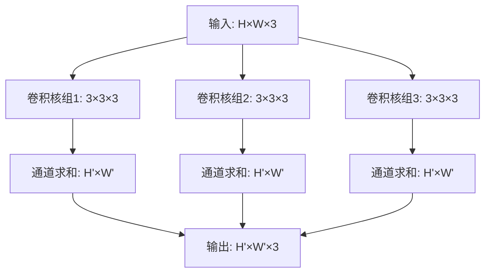

# 深度学习

相关链接：

- [AIGC-Interview-Book-深度学习基础](https://github.com/WeThinkIn/AIGC-Interview-Book/tree/main/%E6%B7%B1%E5%BA%A6%E5%AD%A6%E4%B9%A0%E5%9F%BA%E7%A1%80)
- [AIGC-Interview-Book-深度学习基础-基础概念问答扫盲](https://github.com/WeThinkIn/AIGC-Interview-Book/blob/main/%E6%B7%B1%E5%BA%A6%E5%AD%A6%E4%B9%A0%E5%9F%BA%E7%A1%80/02_%E5%9F%BA%E7%A1%80%E6%A6%82%E5%BF%B5.md#user-content-14%E9%9A%8F%E7%9D%80%E8%BE%B9%E7%BC%98%E8%AE%A1%E7%AE%97%E7%9A%84%E5%85%B4%E8%B5%B7%EF%BC%8C%E6%B7%B1%E5%BA%A6%E5%AD%A6%E4%B9%A0%E5%9C%A8%E8%BE%B9%E7%BC%98%E8%AE%BE%E5%A4%87%E4%B8%8A%E7%9A%84%E5%8F%91%E5%B1%95%E5%91%88%E7%8E%B0%E5%87%BA%E5%93%AA%E4%BA%9B%E7%89%B9%E7%82%B9%EF%BC%9F)

## 一、深度学习导论

### 1.1 **深度学习的定义，与人工智能、机器学习的关系**

**1.1.1 定义**

**深度学习（Deep Learning）** 是机器学习的一个子领域，其核心思想是通过**多层神经网络**自动从数据中学习层次化的特征表示，而无需人工设计特征。

| 领域              | 定义                             | 核心特点                       | 代表技术                     |
| ----------------- | -------------------------------- | ------------------------------ | ---------------------------- |
| **人工智能 (AI)** | 让机器展现出智能行为的广泛领域   | 最广泛的概念，包含所有智能系统 | 专家系统、搜索算法、知识图谱 |
| **机器学习 (ML)** | AI的子集，让机器从数据中学习规律 | 数据驱动，自动改进性能         | 决策树、SVM、随机森林        |
| **深度学习 (DL)** | ML的子集，使用深层神经网络       | 多层特征学习，端到端训练       | CNN、RNN、Transformer        |

**1.1.2 深度学习的核心特征**：

1. **层次化特征学习**：自动从原始数据中学习多层抽象特征
2. **端到端训练**：直接从输入到输出优化，无需人工特征工程
3. **大规模数据驱动**：数据量越大，性能提升越明显
4. **高计算需求**：依赖 GPU/TPU 等并行计算硬件

---

### 1.2 **"深度"的优势：层次化特征表示**

"深度"指的是神经网络中**隐藏层（Hidden Layers）的数量**，即从输入到输出之间数据经过的层数。

**1.2.1 深度带来的核心优势**：

| 优势               | 说明                             | 数学直觉                                  |
| ------------------ | -------------------------------- | ----------------------------------------- |
| **层次化特征表示** | 浅层学简单特征，深层学复杂特征   | 低层：边缘 → 中层：形状 → 高层：物体      |
| **指数级表达能力** | 深层网络比浅层网络参数效率更高   | 深度网络可用更少参数表达相同函数          |
| **抽象层次递进**   | 每一层对上一层的特征进行抽象组合 | $h^{(l)} = f(W^{(l)}h^{(l-1)} + b^{(l)})$ |

**深度与特征层次的关系（以图像识别为例）**

```
Layer 1-2:  边缘检测（线条、角点、简单纹理）
Layer 3-4:  局部形状（眼睛、耳朵、轮廓）
Layer 5-6:  物体部件（人脸、车身）
Layer 7+:   完整物体（人、汽车、场景）
```

**1.2.2 三大领域应用**：

- **AIGC领域**：Stable Diffusion的U-Net有数十层，浅层学习图像的低频信息（整体布局），深层学习高频细节（纹理、边缘），最终生成高质量图像。
- **传统深度学习**：ResNet-152通过152层实现ImageNet分类，残差连接让深层网络可训练，证明了深度的价值。
- **自动驾驶**：感知网络通常有50-100层，浅层检测车道线、交通标志，深层理解场景语义、预测行人意图。
- **最新补充（2026年视角）**：2024-2025年的研究表明，网络深度的重要性正在发生变化。**Mamba等状态空间模型**通过序列建模实现了线性复杂度，而**混合专家（MoE）架构**则通过"宽度"（专家数量）而非"深度"来扩展模型能力。GPT-4等模型虽然参数量巨大，但实际推理时只激活部分参数，"有效深度"的概念变得更加复杂。

---

### 1.3 **深度学习 vs 传统机器学习**

深度学习与传统机器学习最本质的区别在于**特征表示的获取方式**：

* 传统机器学习依赖**人工设计特征**；
* 深度学习则**自动学习特征表示**。

**1.3.1 差异分析**：

| 维度             | 传统机器学习             | 深度学习              |
| ---------------- | ------------------------ | --------------------- |
| **特征工程**     | 需要领域专家手工设计     | 自动从数据中学习      |
| **数据需求**     | 小样本即可有效           | 需要大量数据          |
| **计算资源**     | CPU即可，计算量小        | 需要GPU/TPU，计算量大 |
| **模型可解释性** | 较好（决策树、线性模型） | 较差（黑盒特性）      |
| **性能上限**     | 受特征质量限制           | 随数据和模型规模提升  |
| **训练时间**     | 较短（分钟到小时）       | 较长（小时到周）      |

```
传统机器学习流程：
┌─────────┐    ┌─────────────────┐    ┌─────────────┐
│ 原始数据 │ → │ 人工特征工程     │ → │ 分类器/回归器 │
│         │    │ (SIFT, HOG, TF-IDF)│    │ (SVM, RF)   │
└─────────┘    └─────────────────┘    └─────────────┘
                     ↑
              需要领域专业知识！

深度学习流程：
┌─────────┐    ┌─────────────────────────────────┐
│ 原始数据 │ → │        端到端神经网络            │
│         │    │  (特征学习 + 分类一体化)         │
└─────────┘    └─────────────────────────────────┘
                     ↑
              自动学习特征，无需人工干预！
```

**1.3.2 数学视角的差异**：

- **传统机器学习**：固定特征映射 + 可学习分类器，即 $y = f(\phi(x); \theta)$。其中 $\phi(x)$ 是人工设计的特征提取函数。
- **深度学习**：特征映射和分类器联合学习，即 $y = f(x; \theta) = f_L(f_{L-1}(...f_1(x; \theta_1)...); \theta_L)$。所有层的参数 $\{\theta_1, ..., \theta_L\}$ 同时优化。

**1.3.3 适用场景分析**：

| 场景               | 推荐方法                    | 理由                       |
| ------------------ |-------------------------| -------------------------- |
| 结构化表格数据     | 传统 ML（XGBoost、LightGBM） | 特征有意义，数据量适中     |
| 图像/语音/视频     | 深度学习                    | 原始特征复杂，需要自动学习 |
| 小样本场景         | 传统 ML + 迁移学习            | 深度学习容易过拟合         |
| 实时推理（低延迟） | 传统 ML                   | 模型小，推理快             |
| 追求极致性能       | 深度学习                    | 大数据+大模型=最佳性能     |

**1.3.4 三大领域应用**

- **AIGC领域**：文本生成不可能手工设计"好的文本"的特征，必须用深度学习从海量文本中自动学习语言规律。
- **传统深度学习**：ImageNet 分类准确率从传统方法的 ~70% 提升到深度学习的 ~90%+，证明了自动特征学习的威力。
- **自动驾驶**：传统方法需要人工设计"车道线检测算法"、"行人检测算法"，深度学习则端到端学习从图像到驾驶决策。
- **最新补充（2026年视角）：** 2025 年出现了**基础模型+微调**的新范式。现在可以用少量数据微调大模型（如 LoRA、Adapter），既享受深度学习的表示能力，又只需要传统 ML 级别的数据量。同时，**AutoML** 工具正在自动化传统机器学习的特征工程，两种方法的边界正在融合。

---

### 1.4 **表示学习**

**表示学习（Representation Learning）** 是指让机器自动学习数据的**有效表示（Representation）**，使得后续任务（如分类、回归）变得更容易。深度学习通过**多层非线性变换**实现层次化的表示学习。

**1.4.1 表示学习的核心思想**

原始数据 → 学习到的表示 → 下游任务

$$
x \xrightarrow{f_\theta} h \xrightarrow{g_\phi} y
$$

其中：

- $x$：原始输入（如图像像素、文本词向量）
- $h$：学习到的表示（高层特征）
- $y$：任务输出（如分类标签）
- $f_\theta$：表示学习函数（神经网络前几层）
- $g_\phi$：任务特定函数（神经网络后几层）

**1.4.2 什么是"好的表示"？**

| 特性       | 说明                 | 例子                           |
| ---------- | -------------------- | ------------------------------ |
| **判别性** | 不同类别的表示差异大 | 猫和狗的特征向量距离远         |
| **不变性** | 对无关变化保持稳定   | 同一只猫不同角度的特征相似     |
| **解耦性** | 各维度相互独立       | 一个维度控制颜色，一个控制形状 |
| **抽象性** | 逐层更加抽象         | 边缘→形状→物体→概念            |

**1.4.3 深度学习实现表示学习的机制**

```
输入图像         Layer 1          Layer 2          Layer 3         表示向量
┌───────┐      ┌───────┐       ┌───────┐       ┌───────┐       ┌───────┐
│ 像素  │  →   │ 边缘  │   →   │ 纹理  │   →   │ 部件  │   →   │ 语义  │
│ 224×224│     │ 112×112│      │ 56×56 │       │ 28×28 │       │ 1×512 │
└───────┘      └───────┘       └───────┘       └───────┘       └───────┘
   原始          低级特征        中级特征         高级特征        抽象表示

每一层通过非线性变换提取更抽象的特征：
h^{(l)} = \sigma(W^{(l)} h^{(l-1)} + b^{(l)})
```

**1.4.4 表示学习的两种范式**

| 范式               | 训练方式             | 代表方法          | 优势                 |
| ------------------ | -------------------- | ----------------- | -------------------- |
| **监督表示学习**   | 有标签数据驱动       | 分类任务训练CNN   | 任务特定，效果好     |
| **自监督表示学习** | 无标签，自造监督信号 | BERT、MAE、SimCLR | 数据效率高，泛化性强 |

**1.4.5 三大领域应用**

- **AIGC领域**：CLIP模型学习图像和文本的统一表示空间，使得"用文字搜索图片"成为可能。Stable Diffusion 的文本编码器将 prompt 转换为语义表示向量。
- **传统深度学习**：预训练的 ResNet、BERT 作为特征提取器，在下游任务上只需少量数据即可达到优异性能。迁移学习的核心就是表示的复用。
- **自动驾驶**：BEV（鸟瞰图）表示学习将多摄像头图像统一到3D空间表示，使感知、预测、规划在同一表示空间进行。
- **最新补充（2026年视角）：** 2024-2025年，**自监督表示学习**取得重大突破。**MAE（Masked Autoencoder）**、**DINOv2** 等方法证明了无标签数据可以学习到与监督学习相当甚至更好的表示。**多模态表示学习**（如GPT-4V、Gemini）正在构建统一的视觉-语言表示空间，朝着"通用表示"的目标迈进。

---

### 1.5 **深度学习的核心假设：分层特征提取**

深度学习的核心假设是**层次化表示假设（Hierarchical Representation Hypothesis）**：自然界的复杂概念可以分解为层次化的简单概念组合，深层网络正是通过逐层组合低级特征来构建高级概念。

**1.5.1 核心假设的内容**：

- **假设1：层次化结构假设**

> 自然数据（图像、语音、文本）具有内在的层次结构，复杂概念由简单概念组合而成。

- **假设2：分布式表示假设**

> 概念应该用多个维度的向量表示，而非单一符号。每个维度编码一个属性。

- **假设3：特征复用假设**

> 低级特征可以被多个高级特征共享和复用，形成参数高效的表示。

**1.5.2 为什么分层特征提取有效：表达能力优秀**

**定理（深度网络的指数优势）**：对于某些函数，深度为 $d$ 的网络可以用 $O(d)$ 个参数表示，而深度为 $O(1)$ 的网络需要 $O(2^d)$ 个参数。

**例子**：表示 $d$ 位奇偶函数

- 深度网络：$O(d)$ 个神经元
- 浅层网络：$O(2^d)$ 个神经元

**1.5.3 三大领域应用：**

- **AIGC领域**：Stable Diffusion 的 U-Net 编码器分层提取图像特征，浅层编码布局，深层编码细节，实现了可控的图像生成。
- **传统深度学习**：CNN 的成功正是因为卷积操作的层次堆叠完美匹配图像的层次结构——局部相关性 + 平移不变性。
- **自动驾驶**：感知系统分层处理——底层检测车道线和障碍物，中层预测运动轨迹，高层进行行为决策，每一层都建立在前一层的基础上。
- **最新补充（2026年视角）：** 2025年的研究对层次化假设提出了新的理解。**Vision Transformer（ViT）** 的成功表明，即使没有明确的层次结构（ViT是各向同性的），通过**自注意力机制**也能学习到隐式的层次表示。同时，**Mamba 等 SSM 架构**提供了另一种组织信息的方式，挑战了"必须深层才能表达复杂概念"的传统假设。

---

### 1.6 **深度学习的核心特征，与浅层模型相比的优势**

**1.6.1 深度学习的核心特征**

深度学习的核心特征可以概括为**"三层特性"**：层次化特征学习、分布式表示、端到端优化。

| 特征               | 定义                                 | 优势体现                       |
| ------------------ | ------------------------------------ | ------------------------------ |
| **层次化特征学习** | 多层网络逐层提取抽象特征             | 自动学习从低级到高级的特征层次 |
| **分布式表示**     | 概念用高维向量表示，每个维度编码属性 | 指数级的表示能力，泛化性强     |
| **端到端优化**     | 从原始输入到最终输出的联合优化       | 避免误差累积，全局最优         |
| **非线性变换**     | 激活函数引入非线性                   | 可以拟合任意复杂函数           |
| **参数共享**       | 卷积等操作复用参数                   | 参数效率高，泛化能力强         |

**1.6.2 与浅层模型对比**

| 维度         | 浅层模型（SVM、决策树等）  | 深度学习                       |
| ------------ | -------------------------- | ------------------------------ |
| **表示能力** | 有限，依赖特征工程         | 强大，自动学习特征             |
| **数据利用** | 小数据即可，大数据提升有限 | 小数据易过拟合，大数据持续提升 |
| **特征复用** | 特征独立，难以复用         | 低层特征被高层共享             |
| **抽象能力** | 无法自动抽象               | 逐层抽象，捕捉高级语义         |
| **泛化机制** | 正则化、核技巧             | Dropout、归一化、数据增强      |

**1.6.3 分布式表示**

**例子：表示"红色的圆形苹果"**

- **局部表示（传统方法）**：

```
需要为每种组合分配一个符号：
红苹果-001, 绿苹果-002, 红橙子-003...
组合爆炸：N个属性 × M个值 = N×M 个符号
```

- **分布式表示（深度学习）**：

```
向量 [颜色, 形状, 类别, ...]
红苹果 ≈ [0.9, 0.1, 0.8, ...]  # 红、圆、水果
绿苹果 ≈ [0.2, 0.1, 0.8, ...]  # 绿、圆、水果

只需 N 个维度，可以表示 M^N 种组合！
```

---

### 1.7 **深度学习依赖的三大支柱：数据、算力、算法**

深度学习的成功依赖三大支柱：海量数据、强大算力、有效算法。

**1.7.1 三大支柱详解**

| 支柱     | 作用         | 具体要求                   | 2026年现状                     |
| -------- | ------------ | -------------------------- | ------------------------------ |
| **数据** | 提供学习素材 | 数量、质量、多样性         | GPT-4训练数据~13万亿tokens     |
| **算力** | 执行计算任务 | GPU/TPU集群、显存、带宽    | 万卡H100集群，ExaFLOPS级别     |
| **算法** | 定义学习规则 | 架构设计、优化方法、正则化 | Transformer、MoE、混合精度训练 |

**（1）数据质量维度**：

- **准确性**：标签正确无误
- **多样性**：覆盖各种场景和边界情况
- **平衡性**：类别分布合理，无严重偏差
- **时效性**：反映当前任务的数据分布

**（2）算力演进历程**：

| 年代 | 硬件           | 典型算力     | 代表模型     |
| ---- | -------------- | ------------ | ------------ |
| 2012 | GTX 580        | ~1 TFLOPS    | AlexNet      |
| 2016 | Pascal P100    | ~10 TFLOPS   | ResNet       |
| 2020 | Ampere A100    | ~312 TFLOPS  | GPT-3        |
| 2024 | Hopper H100    | ~2000 TFLOPS | GPT-4        |
| 2026 | Blackwell B200 | ~4500 TFLOPS | 下一代大模型 |

**（3）算法关键突破**：

| 突破点         | 贡献               | 代表工作             |
| -------------- | ------------------ | -------------------- |
| **激活函数**   | 缓解梯度消失       | ReLU、GELU           |
| **归一化**     | 加速训练收敛       | BatchNorm、LayerNorm |
| **残差连接**   | 支持超深网络       | ResNet               |
| **注意力机制** | 捕捉长距离依赖     | Transformer          |
| **预训练范式** | 充分利用无标签数据 | BERT、GPT            |
| **高效架构**   | 降低计算成本       | MoE、FlashAttention  |

**1.7.2 三要素的协同关系**

```
        ┌─────────┐
        │  数据   │
        └────┬────┘
             │ 更多数据需要更强算力处理
             ↓
        ┌─────────┐
        │  算力   │ ←── 更好算法提高算力利用率
        └────┬────┘
             │ 更强算力支持更复杂算法
             ↓
        ┌─────────┐
        │  算法   │ ←── 更好算法减少数据需求
        └────┬────┘
             │ 算法改进提升数据效率
             ↓
        ┌─────────┐
        │  数据   │ （形成正向循环）
        └─────────┘
```

---

### 1.8 **深度学习的局限性**

尽管深度学习取得了巨大成功，但仍面临可解释性、数据依赖、泛化能力、安全性和计算成本等多方面的挑战。

**1.8.1 主要局限性**

| 挑战           | 问题描述                 | 影响程度 | 当前进展               |
| -------------- | ------------------------ | -------- |--------------------|
| **可解释性差** | 黑盒模型难以理解决策原因 | ⭐⭐⭐⭐⭐    | SHAP、Attention 可视化 |
| **数据饥渴**   | 需要大量标注数据         | ⭐⭐⭐⭐⭐    | 自监督学习、合成数据         |
| **分布外泛化** | 对训练分布外的数据表现差 | ⭐⭐⭐⭐⭐    | 域适应、因果学习           |
| **对抗脆弱性** | 小扰动可导致错误预测     | ⭐⭐⭐⭐     | 对抗训练、鲁棒优化          |
| **计算成本高** | 训练和部署资源消耗大     | ⭐⭐⭐⭐     | 模型压缩、高效架构          |
| **缺乏常识**   | 缺乏物理世界常识         | ⭐⭐⭐⭐     | 知识增强、多模态学习         |
| **灾难性遗忘** | 学习新任务会遗忘旧任务   | ⭐⭐⭐      | 持续学习方法             |

**（1）可解释性挑战的解决方案**：

- **事后解释**：LIME、SHAP、Grad-CAM
- **内在可解释**：注意力权重、决策树混合模型
- **概念解释**：TCAV（Testing with Concept Activation Vectors）

**（2）数据依赖问题的解决方案**：

* 数据增强、合成数据
* 迁移学习、预训练+微调
* 少样本学习、元学习

**（3）分布外（OOD）泛化问题**

| 场景   | 训练分布     | 测试分布     | 结果       |
| ------ | ------------ | ------------ | ---------- |
| 正常   | 晴天驾驶图像 | 晴天驾驶图像 | ✓ 高准确率 |
| OOD    | 晴天驾驶图像 | 雨雪天气图像 | ✗ 性能骤降 |
| 域偏移 | 医院A的X光片 | 医院B的X光片 | ✗ 诊断错误 |

**（4）对抗鲁棒性问题**

```python
# 对抗攻击示例
原始图像 x → 模型预测: "熊猫" (置信度 57.7%)

添加人眼不可见的扰动 ε:
x_adv = x + ε · sign(∇_x Loss)

对抗样本 x_adv → 模型预测: "长臂猿" (置信度 99.3%)
```

**1.8.2 三大领域应用**

- **AIGC领域**：大语言模型的"幻觉"问题——自信地输出错误信息；版权争议——训练数据的合法性；偏见问题——反映训练数据中的社会偏见。
- **传统深度学习**：医疗AI的诊断结果难以被医生采纳，因为无法解释决策依据；金融风控模型必须可解释才能满足监管要求。
- **自动驾驶**：长尾场景问题——遇到训练中罕见的场景（如穿着怪异服装的行人）可能误判；安全问题——对抗攻击可能导致错误决策。
- **最新补充（2026年视角）：** 2024-2025年，**AI安全与对齐**成为研究热点：
    - **Constitutional AI**：通过宪法原则约束模型行为
    - **RLHF/RLAIF**：人类/AI反馈强化学习，使模型更符合人类价值观
    - **红队测试**：系统性发现模型漏洞和潜在风险
    - **可解释性突破**：机械可解释性（Mechanistic Interpretability）开始揭示大模型的内部工作机制

---

### 1.9 **深度学习与统计学习、概率模型的联系与区别**

深度学习和统计学习都源自**从数据中学习模式**这一共同目标，但在方法论、假设和侧重点上有显著差异。现代深度学习正在与概率模型融合，形成新的研究方向。

---

### 1.10 **端到端学习**

**端到端学习（End-to-End Learning）** 是指使用单个可微分模型直接从原始输入学习到最终输出，跳过传统流水线中的手工设计中间步骤，通过联合优化所有模块来最小化最终任务损失。

**1.10.1 传统流水线 vs 端到端学习**

- **传统流水线方法**：

```
┌───────┐   ┌───────────┐   ┌───────────┐   ┌───────────┐   ┌───────┐
│原始输入│ → │预处理     │ → │特征提取   │ → │特征选择   │ → │分类器 │ → 输出
│       │   │(手工设计) │   │(SIFT/HOG) │   │(PCA/LDA)  │   │(SVM)  │
└───────┘   └───────────┘   └───────────┘   └───────────┘   └───────┘
                 ↑               ↑               ↑            ↑
            每个模块独立设计，误差累积，次优解
```

- **端到端学习方法**：

```
┌───────┐                                          ┌───────┐
│原始输入│ ──────────→ [深度神经网络] ──────────→ │ 输出  │
└───────┘                                          └───────┘
                        ↑
            所有模块联合优化，全局最优
```

**1.10.2 端到端学习的核心要素**

| 要素         | 说明               | 为什么重要               |
| ------------ | ------------------ | ------------------------ |
| **可微分**   | 整个流程可计算梯度 | 允许反向传播优化所有参数 |
| **联合优化** | 所有模块共同训练   | 避免模块间误差累积       |
| **原始输入** | 直接从数据学习     | 不损失原始信息           |
| **任务驱动** | 以最终目标为导向   | 学习任务相关的特征       |

**1.10.3 端到端学习的优势**

| 优势             | 说明             | 例子                            |
| ---------------- | ---------------- | ------------------------------- |
| **简化系统设计** | 无需设计多个模块 | 语音识别：声学模型+语言模型统一 |
| **避免误差累积** | 全局优化         | 传统OCR：字符分割错误影响识别   |
| **自动特征学习** | 学习任务最优特征 | CNN自动学习图像特征             |
| **更好的性能**   | 理论上达到更优解 | 神经机器翻译超越统计方法        |
| **减少人工干预** | 不需要领域专家   | 自动驾驶直接从图像到控制        |

**1.10.4 端到端学习的挑战**

| 挑战             | 说明                     | 应对策略               |
| ---------------- | ------------------------ | ---------------------- |
| **数据需求大**   | 需要足够数据学习所有层次 | 预训练、迁移学习       |
| **可解释性差**   | 中间过程难以理解         | 注意力可视化、探针任务 |
| **训练困难**     | 深层网络优化挑战         | 残差连接、归一化       |
| **调试复杂**     | 难以定位问题模块         | 模块化设计、渐进训练   |
| **缺乏先验知识** | 忽略领域知识             | 知识蒸馏、混合架构     |

**1.10.5 端到端 vs 模块化：何时选择？**

| 场景     | 推荐方法 | 原因                     |
| -------- | -------- | ------------------------ |
| 数据充足 | 端到端   | 充分发挥自动学习优势     |
| 数据稀缺 | 模块化   | 利用领域知识弥补数据不足 |
| 安全关键 | 混合方法 | 保留可解释性和可调试性   |
| 研究原型 | 端到端   | 快速迭代，简化开发       |
| 生产部署 | 混合方法 | 可维护性和稳定性         |

**1.10.6 三大领域应用**

- **AIGC领域**：ChatGPT 是端到端学习的极致体现——从用户输入直接到生成回复，没有分词、句法分析、语义理解等独立模块，所有能力都在训练中涌现。
- **传统深度学习**：语音识别从传统的"声学模型→发音词典→语言模型"流水线，发展为端到端的"波形→文本"（如 Whisper），大幅提升了性能和简化了系统。
- **自动驾驶**：Tesla FSD 采用端到端方法——从摄像头图像直接输出驾驶控制，取代了传统的"感知→预测→规划→控制"分离架构。
- **最新补充（2026年视角）：** 2025年出现了**"混合端到端"**的新趋势：
    - **模块化端到端**：保持模块结构但联合训练，如自动驾驶的 UniAD
    - **知识引导的端到端**：将领域知识作为约束或先验融入模型
    - **可解释端到端**：如思维链（Chain-of-Thought）使大模型的推理过程可追溯

端到端与模块化不再是二选一，而是根据场景灵活组合的设计选择。

---

### 1.11 **深度学习在小数据场景下的解决方案**

深度学习在大数据时代的突破源于其**高容量模型与海量数据的完美匹配**：模型的数百万甚至数千亿参数可以从数据中学习复杂的模式。在小数据场景下，需要通过**迁移学习、数据增强、元学习**等技术来弥补数据不足。

**1.11.1 三大领域应用**

- **AIGC领域**：大语言模型需要万亿级tokens训练，但通过**指令微调**，只需几万条高质量指令数据就能让模型遵循人类意图。
- **传统深度学习**：医疗影像诊断通常只有几百张标注图像，通过ImageNet预训练+领域微调，可以达到专家级诊断水平。
- **自动驾驶**：真实事故数据极其稀少，通过**仿真环境生成**、**域适应技术**来学习处理危险场景。
- **最新补充（2026年视角）：** 2024-2025年小数据学习取得重要进展：
    - **合成数据**：用大模型生成高质量训练数据，Microsoft的Phi系列证明了"教科书质量数据"的重要性
    - **数据效率革命**：Llama 3用15T tokens训练，但推理能力相当的小模型正在涌现
    - **课程学习**：从简单到复杂组织训练数据，提高学习效率
    - **主动学习**：智能选择最有价值的样本进行标注，最大化标注效率

---

### 1.12 **可解释性问题及其解决方案**

**可解释性问题**是指深度神经网络的决策过程难以被人类理解的特性。由于深度网络通常包含数百万到数千亿参数，其决策逻辑分布在大量神经元中，形成"黑盒"特性。当前解决方案分为**事后解释**和**内在可解释**两大类。

---

### 1.13 **深度学习在不同数据模态上的应用**

不同数据模态具有**不同的结构特性**，这决定了适合的神经网络架构。但 **Transformer 架构的通用性**正在打破模态边界，实现"一种架构统治所有模态"的愿景。

---

### 1.14 **模型评估指标**

评估深度学习模型需要从**多个维度**进行：准确性、效率、鲁棒性、公平性等。不同任务类型有对应的评估指标，选择合适的指标对于正确评估模型至关重要。

**1.14.1 评估维度全景**

```
                    模型评估
                       │
       ┌───────────────┼───────────────┐
       │               │               │
    准确性           效率性          可靠性
       │               │               │
   ┌───┴───┐       ┌───┴───┐       ┌───┴───┐
  分类    回归    推理速度  模型大小   鲁棒性  不确定性
  指标    指标    训练时间  内存占用   公平性  可解释性
```

**1.14.2 分类任务评估指标**

| 指标                    | 公式                              | 适用场景       | 局限性           |
| ----------------------- | --------------------------------- | -------------- | ---------------- |
| **准确率（Accuracy）**  | $\frac{TP+TN}{TP+TN+FP+FN}$       | 类别平衡       | 不适合不平衡数据 |
| **精确率（Precision）** | $\frac{TP}{TP+FP}$                | 假正代价高     | 忽略假负         |
| **召回率（Recall）**    | $\frac{TP}{TP+FN}$                | 假负代价高     | 忽略假正         |
| **F1-Score**            | $\frac{2 \cdot P \cdot R}{P + R}$ | 平衡P和R       | 不适合所有场景   |
| **AUC-ROC**             | ROC曲线下面积                     | 类别不平衡评估 | 不适合极度不平衡 |

**混淆矩阵**：

```
                 预测
              正例    负例
        ┌────────┬────────┐
   正例  │   TP   │   FN   │  ← 召回率 = TP/(TP+FN)
真实     ├────────┼────────┤
   负例  │   FP   │   TN   │
        └────────┴────────┘
            ↑
     精确率 = TP/(TP+FP)
```

**1.14.3 回归任务评估指标**

| 指标     | 公式                                               | 特点           |
| -------- | -------------------------------------------------- | -------------- |
| **MAE**  | $\frac{1}{n}\sum_{i=1}^{n}\lvert y_i - \hat{y}_i\rvert$                 | 对异常值鲁棒   |
| **MSE**  | $\frac{1}{n}\sum_{i=1}^{n}(y_i - \hat{y}_i)^2$               | 惩罚大误差     |
| **RMSE** | $\sqrt{MSE}$                                       | 与原数据同量纲 |
| **R²**   | $1 - \frac{SS_{res}}{SS_{tot}}$                    | 解释方差比例   |
| **MAPE** | $\frac{100\%}{n}\sum_{i=1}^{n}\left\lvert\frac{y_i - \hat{y}_i}{y_i}\right\rvert$ | 相对误差百分比 |

**1.14.4 生成任务评估指标**

| 指标           | 适用任务 | 原理         | 局限性         |
| -------------- | -------- | ------------ | -------------- |
| **BLEU**       | 机器翻译 | N-gram匹配   | 忽略语义       |
| **ROUGE**      | 文本摘要 | 召回率导向   | 同上           |
| **Perplexity** | 语言模型 | 困惑度       | 不完全反映质量 |
| **FID**        | 图像生成 | 特征分布距离 | 需要预训练模型 |
| **CLIP Score** | 文生图   | 图文匹配度   | 依赖CLIP模型   |

**1.14.5 效率指标**

| 指标         | 说明           | 重要性       |
| ------------ | -------------- | ------------ |
| **推理延迟** | 单次推理时间   | 实时应用关键 |
| **吞吐量**   | 单位时间处理量 | 批量处理场景 |
| **参数量**   | 模型参数总数   | 存储需求     |
| **FLOPs**    | 浮点运算次数   | 计算需求     |
| **显存占用** | GPU内存需求    | 硬件限制     |

**1.14.6 鲁棒性与公平性**

**鲁棒性评估**：

- 对抗鲁棒性：对抗样本上的准确率
- 分布偏移：OOD 数据上的性能
- 自然扰动：噪声、模糊、遮挡等

**公平性评估**：

| 指标               | 定义               |
| ------------------ | ------------------ |
| **人口统计学均等** | 预测与敏感属性独立 |
| **机会均等**       | 各组的TPR相同      |
| **预测平价**       | 各组的精确率相同   |

---

### 1.15 **大模型时代的深度学习：基础模型范式**

大模型时代正在**重新定义深度学习**：从"针对特定任务训练特定模型"到"训练通用大模型，适配多种任务"。**基础模型（Foundation Model）** 代表了这一范式转变：在大规模数据上预训练，具备广泛能力，可通过微调或提示适应各种下游任务。

**1.15.1 深度学习范式的演变**

```
传统范式（2012-2018）：
┌────────────────────────────────────────┐
│  任务A数据 → 训练模型A → 解决任务A     │
│  任务B数据 → 训练模型B → 解决任务B     │
│  任务C数据 → 训练模型C → 解决任务C     │
└────────────────────────────────────────┘
问题：每个任务都需要从头训练，数据和算力浪费

预训练范式（2018-2020）：
┌────────────────────────────────────────┐
│  大规模数据 → 预训练模型 → 微调 → 任务A│
│                        ↘ 微调 → 任务B  │
│                         ↘ 微调 → 任务C │
└────────────────────────────────────────┘
进步：预训练知识可复用，但仍需微调

基础模型范式（2020-至今）：
┌────────────────────────────────────────┐
│  超大规模数据 → 基础模型 → 提示 → 任务A│
│                        ↘ 提示 → 任务B  │
│                         ↘ 提示 → 任务C │
└────────────────────────────────────────┘
革命：零样本/少样本能力，无需参数更新
```

---

### 1.16 **GPU、CUDA**

**1.16.1 定义**

* **GPU（图形处理器）的并行计算能力**是深度学习爆发的硬件基础。
* **CUDA（Compute Unified Device Architecture）**作为 NVIDIA 推出的并行计算平台，使 GPU 从图形渲染扩展到通用计算，为训练大规模神经网络提供了**数百倍的加速**。

**1.16.2 CPU vs GPU 架构对比**

```
CPU（4-64核心）：
┌────────────────────────────────────┐
│ ████████████████████████████████   │ ← 大容量缓存
│ ████████████████████████████████   │ ← 复杂控制逻辑
│ ┌───┐ ┌───┐ ┌───┐ ┌───┐           │ ← 少量强大核心
│ │ALU│ │ALU│ │ALU│ │ALU│           │
│ └───┘ └───┘ └───┘ └───┘           │
│ 专为串行、复杂任务设计              │
└────────────────────────────────────┘

GPU（数千核心）：
┌────────────────────────────────────┐
│ ┌─┐┌─┐┌─┐┌─┐┌─┐┌─┐┌─┐┌─┐┌─┐┌─┐┌─┐│
│ │A││A││A││A││A││A││A││A││A││A││A││ ← 数千小核心
│ └─┘└─┘└─┘└─┘└─┘└─┘└─┘└─┘└─┘└─┘└─┘│
│ ┌─┐┌─┐┌─┐┌─┐┌─┐┌─┐┌─┐┌─┐┌─┐┌─┐┌─┐│
│ │A││A││A││A││A││A││A││A││A││A││A││
│ └─┘└─┘└─┘└─┘└─┘└─┘└─┘└─┘└─┘└─┘└─┘│
│ 专为大规模并行计算设计              │
└────────────────────────────────────┘
```

**1.16.3 CPU vs GPU 性能对比**

| 任务                    | CPU时间 | GPU时间 | 加速比 |
| ----------------------- | ------- | ------- | ------ |
| 矩阵乘法 (1024×1024)    | 2.5秒   | 0.02秒  | 125x   |
| CNN前向传播             | 1.0秒   | 0.01秒  | 100x   |
| 训练AlexNet (90 epochs) | 数周    | 5-6天   | 10-50x |


**1.16.4 CUDA 简介**

CUDA 是 NVIDIA 于 2007 年推出的**并行计算平台和编程模型**：

- 让开发者可以用类 C 语言编写 GPU 程序
- 提供了丰富的库（cuBLAS、cuDNN等）
- 使 GPU 从"图形专用"变为"通用并行计算"

```C
# CUDA C 代码示例：向量加法
__global__ void vectorAdd(float *a, float *b, float *c, int n) {
    int i = blockIdx.x * blockDim.x + threadIdx.x;
    if (i < n) {
        c[i] = a[i] + b[i];
    }
}
// 简单直观，类似C语言！
```

**CUDA 生态**

| 组件             | 功能         | 深度学习中的作用 |
| ---------------- | ------------ | ---------------- |
| **CUDA Runtime** | GPU执行管理  | 基础运行环境     |
| **cuBLAS**       | GPU线性代数  | 矩阵乘法加速     |
| **cuDNN**        | 深度学习原语 | 卷积、池化等加速 |
| **NCCL**         | 多GPU通信    | 分布式训练       |


**1.16.5 多GPU训练技术**

| 技术           | 说明             | 适用场景    |
| -------------- | ---------------- | ----------- |
| **数据并行**   | 每卡处理不同数据 | 大batch训练 |
| **模型并行**   | 模型切分到多卡   | 超大模型    |
| **流水线并行** | 层间并行         | 超深网络    |
| **ZeRO优化**   | 优化器状态分片   | 大模型训练  |

---

## 二、神经网络基础

### 2.1 **人工神经元**

人工神经元的数学模型是**加权求和 + 非线性激活**：

$$
y = f\left(\sum_{i=1}^{n} w_i x_i + b\right)
$$

包含四个核心部分：**输入（$x$）、权重（$w$）、偏置（$b$）、激活函数（$f$）**。

---

### 2.2 **感知机**

**感知机（Perceptron）** 是由Frank Rosenblatt于1958年提出的最简单的**单层神经网络**，用于**二分类**任务。它由**输入层**和**输出层**组成，使用**阶跃激活函数**，通过**感知机学习规则**调整权重。

**感知机的结构**

```
感知机结构：

        x₁ ───→ w₁ ──┐
                    │
        x₂ ───→ w₂ ──┼──→ z = Σwᵢxᵢ + b ──→ sign(z) ──→ y ∈ {-1, +1}
                    │
        xₙ ───→ wₙ ──┘

输入层（无计算）     加权求和            阶跃激活函数      输出
```

**数学表达式**

$$
y = \operatorname{sign}\left(\sum_{i=1}^{n} w_i x_i + b\right)
=
\begin{cases}
+1, & \text{if } \mathbf{w}^T \mathbf{x} + b > 0, \\
-1, & \text{otherwise.}
\end{cases}
$$

**几何解释**

感知机学习的是一个**超平面**决策边界：

```
以 AND 为例

x₂
1 |    ○ (0,1)          ● (1,1)
  |
0 |    ○ (0,0)          ○ (1,0)
  |
  +------------------------------- x₁
       0                  1

图例：
○ 表示类别 0
● 表示类别 1

可用一条直线分开
```

**决策边界的数学形式**：

$$
\mathbf{w}^T \mathbf{x} + b = 0
$$

- 权重 $\mathbf{w}$ 决定超平面的**方向**（法向量）
- 偏置 $b$ 决定超平面的**位置**（到原点的距离）

**感知机学习算法**

**初始化**：随机初始化权重 $\mathbf{w}$ 和偏置 $b$

**对于每个训练样本 $(x^{(i)}, y^{(i)})$**：

1. 计算预测值：$\hat{y}^{(i)} = \text{sign}(\mathbf{w}^T \mathbf{x}^{(i)} + b)$
2. 如果 $\hat{y}^{(i)} \neq y^{(i)}$（预测错误）：
     - $\mathbf{w} \leftarrow \mathbf{w} + \eta \cdot y^{(i)} \cdot \mathbf{x}^{(i)}$
     - $b \leftarrow b + \eta \cdot y^{(i)}$

其中 $\eta$ 是学习率。

**感知机的特点**

| 特点         | 说明                       |
| ------------ | -------------------------- |
| **结构简单** | 只有一层，无隐藏层         |
| **线性分类** | 只能解决线性可分问题       |
| **在线学习** | 样本可以逐个输入学习       |
| **收敛保证** | 如果数据线性可分，必定收敛 |

**感知机的局限性**

```
感知机无法解决的问题：XOR

x₂
1 |    ● (0,1)          ○ (1,1)
  |
0 |    ○ (0,0)          ● (1,0)
  |
  +------------------------------- x₁
       0                  1

图例：
○ 表示类别 0
● 表示类别 1

无法用一条直线分开！
需要多层感知机（MLP）才能解决
```

---

### 2.3 **多层感知机（MLP）**

**多层感知机（MLP）** 通过添加**隐藏层**和**非线性激活函数**，克服了单层感知机的线性限制。隐藏层进行**特征变换**，将原始输入映射到新的空间，使原本线性不可分的数据变得可分。

**为什么需要非线性激活函数？** —— 如果没有非线性激活函数，多层网络等价于单层网络！

---

### 2.4 **偏置项（Bias）的作用**

**偏置项（Bias）** 的作用是**调整神经元的激活阈值**，使决策边界可以**平移**而不必经过原点。去掉偏置会限制模型的表达能力，因为所有决策边界都必须经过原点。

---

### 2.5 **通用近似定理**

**通用近似定理**（Universal Approximation Theorem）表明：具有**单隐藏层**和**足够多神经元**的前馈神经网络，使用适当的非线性激活函数，可以以任意精度**逼近任何连续函数**。这证明了神经网络的**理论表达能力**，但并不保证实际可学习性。

**定理的数学表述 —— Cybenko (1989) / Hornik (1991) 版本**

> 设 $\sigma$ 是非常数、有界、连续的函数（如Sigmoid）。对于任意连续函数 $f: [0,1]^n \to \mathbb{R}$ 和任意 $\epsilon > 0$，存在整数 $N$、常数 $\alpha_i, b_i \in \mathbb{R}$ 和向量 $\mathbf{w}_i \in \mathbb{R}^n$，使得：
> 
> $$
> \left| f(\mathbf{x}) - \sum_{i=1}^{N} \alpha_i \sigma(\mathbf{w}_i^T \mathbf{x} + b_i) \right| < \epsilon
> $$
> 
> 对所有 $\mathbf{x} \in [0,1]^n$ 成立。

**定理的局限性**

**（1）存在性 vs 构造性**

```
定理告诉我们：
  "存在一个网络能够逼近目标函数"

定理没有告诉我们：
  - 这个网络有多大（N 是多少）
  - 如何找到这个网络（权重是多少）
  - 多少数据才能学习这个网络
```

**（2）实际学习困难**

| 困难           | 说明                         |
| -------------- | ---------------------------- |
| **优化困难**   | 非凸优化，可能陷入局部最优   |
| **数据需求**   | 理论上的网络可能需要海量数据 |
| **过拟合风险** | 参数太多容易过拟合           |
| **计算成本**   | 极宽网络计算成本高           |

---

### 2.6 **宽度与深度对模型的影响**

神经网络的**宽度**（每层神经元数量）和**深度**（网络层数）影响模型的表达能力和训练难度：

* **宽度（Width）**决定了模型在同一层级能并行提取多少种不同的特征；
* **深度（Depth）**决定了模型能进行多少次特征的非线性组合与抽象。
* **表达能力上**，深度带来指数级的抽象能力提升，比单纯增加宽度更高效；
* **训练难度上**，网络越深，越容易出现梯度消失/爆炸和退化问题，优化难度急剧上升。

---

### 2.7 **全零初始化的对称性问题**

**参数初始化**对神经网络的训练至关重要，因为**初始值决定了优化起点**，影响收敛速度和最终性能。

**全零初始化**会导致**对称性问题**——所有神经元学习相同的特征，无法进行有效的特征学习。

**2.7.1 全零初始化的对称性（Symmetry）问题**

```
全零初始化的对称性：

时刻 t=0（初始化）：
  w₁ = w₂ = ... = wₙ = 0

时刻 t=1（第一次更新后）：
  w₁ = w₂ = ... = wₙ = Δw

（因为梯度相同，更新量相同）

时刻 t=k（任意时刻）：
  w₁ = w₂ = ... = wₙ

对称性永远无法打破！
```

全零初始化无法学习不同特征！

```
随机初始化（正确）：

        输入层        隐藏层
          ○ ────────→ ○ (学习特征A)
          ○ ────────→ ○ (学习特征B)
          ○ ────────→ ○ (学习特征C)

每个神经元有不同的初始权重，学习不同特征


全零初始化（错误）：

        输入层        隐藏层
          ○ ────────→ ○ (相同)
          ○ ────────→ ○ (相同)
          ○ ────────→ ○ (相同)

所有神经元永远相同，等于只有一个神经元
```

**2.7.2 偏置初始化**

偏置通常初始化为 **0**（不会导致对称性问题）：$\mathbf{b}^{(l)} = \mathbf{0}$

某些情况下使用小正值：$\mathbf{b}^{(l)} = 0.01 \text{ 或 } 0.1$

这使 ReLU 神经元初始时更可能激活。

---

### 2.8 **对称性破坏方法：随机初始化**

**对称性破坏（Symmetry Breaking）** 是指通过**随机初始化**使各神经元的初始权重不同，从而打破对称性，让每个神经元能够学习**不同的特征**。随机初始化是最简单有效的对称性破坏方法。

```
随机初始化后：

z₁ = w₁₁x₁ + w₁₂x₂ + ... + w₁ₙxₙ  ≠  z₂ = w₂₁x₁ + w₂₂x₂ + ...

因为 w₁ᵢ ≠ w₂ᵢ（随机初始化）

每个神经元的激活值不同！
梯度也不同！
更新后权重继续保持不同！
```

**2.8.1 常用随机初始化方法**

**（1）随机小值初始化**

```python
W = np.random.randn(n_out, n_in) * 0.01
```

- 简单，但深层网络可能有问题
- 值太大会导致梯度爆炸
- 值太小会导致梯度消失

**（2）Xavier/Glorot 初始化**

```python
# 适用于Sigmoid、Tanh等激活函数
std = np.sqrt(2.0 / (n_in + n_out))
W = np.random.randn(n_out, n_in) * std
```

- **原理**：保持输入和输出的方差一致，即 $\text{Var}(z^{(l)}) = \text{Var}(z^{(l-1)})$

**（3）He/Kaiming 初始化**

```python
# 适用于ReLU及其变体
std = np.sqrt(2.0 / n_in)
W = np.random.randn(n_out, n_in) * std
```

- **原理**：考虑ReLU使一半神经元失活，需要额外2倍方差补偿 $\text{Var}(z^{(l)}) = \text{Var}(z^{(l-1)})$

**2.8.2 Xavier初始化的推导**

- **目标**：使前向传播和反向传播的信号保持稳定

- **前向传播**：

$$z^{(l)} = W^{(l)} x^{(l-1)}$$

假设 $W^{(l)}_{ij}$ 独立同分布，均值为0，方差为 $\text{Var}(W)$：

$$\text{Var}(z^{(l)}) = n_{in} \cdot \text{Var}(W) \cdot \text{Var}(x^{(l-1)})$$

为使 $\text{Var}(z^{(l)}) = \text{Var}(x^{(l-1)})$：

$$n_{in} \cdot \text{Var}(W) = 1 \Rightarrow \text{Var}(W) = \frac{1}{n_{in}}$$

- **反向传播**：

$$\frac{\partial L}{\partial x^{(l-1)}} = W^{(l)T} \frac{\partial L}{\partial z^{(l)}}$$

类似分析得：

$$\text{Var}(W) = \frac{1}{n_{out}}$$

- **折中方案**：

$$\text{Var}(W) = \frac{2}{n_{in} + n_{out}}$$

**2.8.3 不同初始化方法对比**

| 方法         | 公式                                              | 适用激活函数  | 特点                 |
| ------------ | ------------------------------------------------- | ------------- | -------------------- |
| **随机小值** | $W \sim \mathcal{N}(0, 0.01^2)$                   | 通用          | 简单，深层网络效果差 |
| **Xavier**   | $W \sim \mathcal{N}(0, \frac{2}{n_{in}+n_{out}})$ | Sigmoid, Tanh | 保持方差稳定         |
| **He**       | $W \sim \mathcal{N}(0, \frac{2}{n_{in}})$         | ReU系列       | ReU专用              |
| **LSUV**     | 迭代调整                                          | 通用          | 更精确但复杂         |

**2.8.4 三大领域应用**

- **AIGC领域**：GPT、BERT 等大模型都使用精心设计的初始化（如He初始化），确保深层网络能够有效训练。
- **传统深度学习**：ResNet 等深层网络的成功，很大程度上归功于正确的初始化策略。
- **自动驾驶**：感知网络通常很深，正确的初始化对训练稳定性至关重要。
- **最新补充（2026年视角）：** 初始化的现代实践：
    - **预训练主导**：大多数情况下使用预训练权重初始化
    - **数据相关初始化**：根据数据分布调整初始化
    - **元学习初始化**：学习最优初始化策略
  
---

### 2.9 **前馈神经网络（FNN）的结构和前向传播过程**

**2.9.1 前馈神经网络的基本结构**

**前馈神经网络（Feedforward Neural Network, FNN）** 是最基础的神经网络类型，也被称为多层感知机（MLP）。

其基本结构由**输入层（Input Layer）**、**隐藏层（Hidden Layer）**和**输出层（Output Layer）**组成。

其核心特征是：**信息只单向流动**，从输入到输出，网络中不存在反馈环路（Feedback Loop）。

**2.9.2 前向传播过程**

前向传播（Forward Propagation）是神经网络**依据输入数据、当前权重和偏置，逐层计算并最终得到预测输出**的过程。其本质是**矩阵乘法与非线性激活的交替嵌套**。

$$\begin{aligned}
\mathbf{a}^{(0)} &= \mathbf{x} \\
\mathbf{a}^{(1)} &= f_1(\mathbf{W}^{(1)}\mathbf{a}^{(0)} + \mathbf{b}^{(1)}) \\
\mathbf{a}^{(2)} &= f_2(\mathbf{W}^{(2)}\mathbf{a}^{(1)} + \mathbf{b}^{(2)}) \\
&\vdots \\
\mathbf{\hat{y}} = \mathbf{a}^{(L)} &= f_L(\mathbf{W}^{(L)}\mathbf{a}^{(L-1)} + \mathbf{b}^{(L)})
\end{aligned}$$

---

### 2.9 **全连接层的参数量**

在全连接层中，上一层的每一个神经元都与本层的每一个神经元相连。其参数总数包含**权重参数**和**偏置参数**。

计算公式为：**参数量 = （输入神经元数 $\times$ 输出神经元数） + 输出神经元数**。

参数过多会导致：**模型极易过拟合**、**显存占用爆炸**以及**计算资源消耗剧增**。

**参数计算详解**

设全连接层的输入维度为 $N_{in}$，输出维度为 $N_{out}$。

* **权重矩阵 $\mathbf{W}$ 的参数量**：$N_{in} \times N_{out}$ （即两层之间连线的总数）
* **偏置向量 $\mathbf{b}$ 的参数量**：$N_{out}$ （每个输出神经元配备一个偏置）
* **总参数量**：$N_{in} \times N_{out} + N_{out}$

---

### 2.10 **过拟合和欠拟合**

* **过拟合（Overfitting）**是指模型在训练集上表现极好，但在验证集/测试集上表现很差，模型"死记硬背"了训练数据的噪声。
* **欠拟合（Underfitting）**是指模型在训练集和验证集上表现都很差，模型未能学习到数据的真实规律。

**诊断方法与学习曲线**

判断的核心在于**观察训练损失（Train Loss）和验证损失（Validation Loss）的动态走势**：

| 状态         | 训练损失 | 验证损失             | 诊断依据                                   | 解决策略                                             |
| ------------ | -------- | -------------------- | ------------------------------------------ | ---------------------------------------------------- |
| **正常拟合** | 持续下降 | 持续下降后趋于稳定   | 训练集和验证集指标同步提升。               | 保持当前策略，适时早停（Early Stopping）。           |
| **欠拟合**   | 居高不下 | 居高不下             | 模型容量不足或训练时间不够。               | 增加模型复杂度（加深/加宽）、减少正则化、训练更久。  |
| **过拟合**   | 逼近于0  | **先下降后反弹上升** | 泛化能力崩溃，模型开始拟合特定样本的噪声。 | 增加数据量、引入数据增强、加大正则化（L2/Dropout）。 |

---

### 2.11 **L 范数正则化**

**正则化**的本质是**对模型的复杂度施加惩罚**，通过在损失函数中引入额外项，限制模型参数的自由度，从而降低过拟合风险，提升泛化能力。

**2.11.1 L1 正则化（Lasso）**

$$L = L_0 + \lambda \sum_{i} |w_i|$$

* **特点**：倾向于产生**稀疏权重矩阵**（让许多权重变为绝对的0）。
* **作用**：天然的特征选择器，忽略不重要的特征。

**2.11.2 L2 正则化（Ridge / 权重衰减 Weight Decay）**

$$L = L_0 + \frac{\lambda}{2} \sum_{i} w_i^2$$

* **特点**：倾向于让权重值变得**均匀且接近于0**，但不会绝对为0。
* **作用**：限制权重突变，使模型对输入微小扰动不敏感，输出更加平滑。

**最新补充（2026年视角）**： 在 MMDetection 等现代框架中，纯粹的 L1/L2 已较少在配置中显式称为 Regularization，而是直接作为优化器参数 `weight_decay` 存在（主要指L2）。特别是在 AdamW 优化器中，解耦的权重衰减（Decoupled Weight Decay）被证明对训练 Transformer 架构（如 Grounding DINO）效果远胜传统的 L2 正则化。

---

### 2.12 **Dropout 正则化**

**2.12.1 定义**

**Dropout** 通过在训练过程中**随机将部分神经元的输出置为 0**（即让它们暂时"失活"），强迫网络不依赖于任何一个局部特征，从而达到正则化效果。它是深度学习中最经典的集成学习（Ensemble）的近似。

**2.12.2 Dropout 训练与推理机制的区别**

| 阶段                 | 行为机制                                                     | 数学操作                                                     | 目的                                                         |
| -------------------- | ------------------------------------------------------------ | ------------------------------------------------------------ | ------------------------------------------------------------ |
| **训练 (Training)**  | 以概率 $p$ 随机丢弃神经元。为了保持期望值不变，保留的神经元输出需**放大** $1/(1-p)$ 倍（Inverted Dropout）。 | $y = \frac{x \cdot m}{1-p}$，其中 $m \sim \text{Bernoulli}(1-p)$ | 打破神经元之间的共适应性（Co-adaptation），防止过拟合。      |
| **推理 (Inference)** | 所有神经元全部激活，**不丢弃**任何节点。                     | $y = x$                                                      | 利用整个完整网络的表征能力进行预测，相当于无数个子网络的集成。 |

**2.12.3 最新补充（2026年视角）**： 在全连接层时代 Dropout 是标配。但在现代视觉架构中：

* 卷积层更倾向于使用 **DropBlock**（丢弃连续的特征区域）。
* Transformer 架构（如 ViT、DETR 系列）大量使用 **DropPath (Stochastic Depth)**，即随机跳过整个残差模块，而不是丢弃单个神经元，这在训练极深网络时效果极佳。

---

### 2.13 **批归一化（BN）**

**批归一化（Batch Normalization, BN）** 主要解决了**内部协变量偏移（Internal Covariate Shift）问题（现代研究更倾向于认为它平滑了损失函数的优化曲面**）。它使得网络允许使用更大的学习率，显著加速收敛，并具有轻微的正则化效果。

**2.13.1 数学推导过程**

对于一个 Mini-batch 中的激活值 $x$，包含 $m$ 个样本，BN 层在特征维度上进行如下计算：

1. 计算 Batch 均值： $\mu_B = \frac{1}{m} \sum_{i=1}^m x_i$
2. 计算 Batch 方差： $\sigma_B^2 = \frac{1}{m} \sum_{i=1}^m (x_i - \mu_B)^2$
3. **标准化（零均值，单位方差）**： $\hat{x}_i = \frac{x_i - \mu_B}{\sqrt{\sigma_B^2 + \epsilon}}$ （$\epsilon$ 防止除零）
4. **仿射变换（恢复表达能力）**： $y_i = \gamma \hat{x}_i + \beta$

> **注意**：这里的 $\gamma$（缩放）和 $\beta$（平移）是**可学习的网络参数**，网络可以借此还原数据原本的分布特征。

**2.13.2 三大领域应用**

- **目标检测**：在恒源云等平台租用多卡 GPU 训练 YOLO 或目标检测模型时，由于每张卡的 Batch Size 往往较小，常规 BN 统计不准，必须使用 **SyncBN（同步批归一化）**，跨卡同步均值和方差，这是涨点的关键细节。
- **自然语言处理**：在处理变长序列时 BN 效果很差，因此 Transformer 等架构抛弃了 BN，转向了 **Layer Normalization (LN)**（在样本内部跨特征维度归一化）。

---

### 2.14 **回归与分类任务的常用损失函数**

损失函数（Loss Function）衡量了模型预测值与真实标签之间的差异。选择损失函数的**核心原则是匹配任务的输出概率分布**。

**2.14.1 常用损失函数分类**

| 任务类型     | 目标属性          | 常用损失函数                      | 优缺点/适用场景                                              |
| ------------ | ----------------- | --------------------------------- | ------------------------------------------------------------ |
| **回归任务** | 预测连续数值      | **MSE（均方误差 / L2 Loss）**     | 对大误差惩罚极强，但容易受异常值（Outlier）主导。            |
|              |                   | **MAE（平均绝对误差 / L1 Loss）** | 对异常值鲁棒，但在0点处不可导，优化不稳定。                  |
|              |                   | **Huber Loss / Smooth L1**        | 结合前两者优点：小误差用L2，大误差用L1。目标检测边界框回归标配。 |
| **分类任务** | 预测离散类别/概率 | **Cross-Entropy (CE, 交叉熵)**    | 梯度下降平稳，多分类标配（结合 Softmax）。                   |
|              |                   | **BCE (二元交叉熵)**              | 用于多标签分类或独立二分类任务。                             |

**2.14.2 三大领域应用**

在**目标检测**（如 DETR 或 YOLO 系列）中，这两类损失函数是同时存在的（Multi-task Learning）：

1. 预测边界框位置 $(x,y,w,h)$ 时，这是一个**回归任务**，通常使用 Smooth L1 Loss 以及基于 IoU 的损失（如 GIoU Loss）。
2. 预测该框内是猫还是狗时，这是一个**分类任务**，通常使用 Cross-Entropy Loss 或者 Focal Loss（用于解决类别极度不平衡问题）。

### 2.15 **交叉熵损失与均方误差损失（MSE）**

**2.15.1 本质区别与适用场景**

两者本质区别在于底层统计假设不同

* **MSE** 假设模型误差服从**高斯分布（正态分布）**，由最大似然估计推导而来，适合**拟合连续的数值空间**。
* **交叉熵（Cross-Entropy）** 假设数据服从**伯努利分布或多项式分布**，本质是衡量两个概率分布（预测概率与真实独热编码）之间的信息熵差异（KL散度）。

**2.15.2 为什么分类任务不用 MSE，而用交叉熵损失？**

在分类网络最后一层通常使用 Sigmoid 或 Softmax 激活函数：

$$f(z) = \frac{1}{1+e^{-z}}$$

如果此时强行使用 MSE Loss，根据链式法则求导，梯度中会包含激活函数的导数项 $f'(z)$。

当预测极其错误（例如标签是1，预测接近0时），$z$ 是极小的负数，此时 $f'(z)$ 趋近于0！这意味着**预测越错，梯度反而越小，模型陷入停滞（梯度消失）**。

而如果使用交叉熵损失：

$$L = -y \log(\hat{y}) - (1-y)\log(1-\hat{y})$$

求导后，神奇地抵消了 $f'(z)$ 中的分母，最终梯度与误差直接成正比：$\frac{\partial L}{\partial z} = \hat{y} - y$。**预测越错，梯度越大，模型纠正越快！**

---

### 2.16 **神经网络的训练过程，Mini-batch SGD的优势**

神经网络训练是一个迭代优化的闭环。核心步骤包含：**数据采样、前向传播、计算损失、反向传播、权重更新**。

**Mini-batch SGD（小批量随机梯度下降）** 是深度学习训练的基石，它在单样本更新（SGD）和全样本更新（BGD）之间取得了最佳的显存/计算平衡。

**训练核心循环代码抽象**

```python
for epoch in range(num_epochs):
    for batch_x, batch_y in dataloader:  # 1. 采样 Mini-batch 数据
        optimizer.zero_grad()            # 清空历史梯度

        preds = model(batch_x)           # 2. 前向传播 (Forward)
        loss = criterion(preds, batch_y) # 3. 计算损失 (Loss)

        loss.backward()                  # 4. 反向传播 (Backward，计算梯度)
        optimizer.step()                 # 5. 权重更新 (Update Weights)
```

**Mini-batch SGD 的三大优势**

1. **并行计算效率**：利用现代 GPU（如恒源云上的 RTX 4090 或 A100）的强大矩阵并行计算能力。单样本无法打满 GPU 算力。
2. **跳出局部最优**：相较于全样本的确定性梯度，Mini-batch 引入了**随机噪声**，这种梯度的抖动有助于模型逃离鞍点（Saddle Points）或较差的局部极小值。
3. **内存友好**：无法将海量数据集（如上百万张的图片）一次性塞入显存，按 Batch 分块是唯一的工程解法。

### 2.17 **学习率**

**学习率（Learning Rate，LR, $\eta$）** 是优化器在梯度下降时迈出的"步长"，是深度学习中最重要的超参数。

* **学习率过大**：模型无法收敛，损失值剧烈震荡，甚至直接发散（Loss 变 NaN）。
* **学习率过小**：训练极其缓慢，极易陷入局部最优解，耗费大量计算资源仍无法拟合。

**如何选取：学习率预热与查找（LR Range Test）**

在实践中，常用 **LR Finder** 策略寻找初始学习率：
从一个极小的值（如 $10^{-7}$）开始，每个 Batch 稍微增加学习率，记录对应的 Loss 值。画出 Loss 随 LR 变化的曲线：

1. 一开始 Loss 下降缓慢（LR 太小）。
2. 随后 Loss 陡峭下降（找到一个**好区间**）。
3. 最后 Loss 反弹飙升（LR 太大）。
   
**合适的初始学习率通常选在 Loss 下降最陡峭区域的中点。**

---

### 2.18 **学习率调度**

**学习率调度（Learning Rate Scheduling）**是指在训练的不同阶段，**动态调整学习率大小**的策略。通常的原则是：训练初期使用较大学习率快速探索全局，中后期逐渐衰减学习率进行精细收敛。

常见调度策略

| 策略名称                        | 工作原理                                                     | 适用场景与框架                                               |
| ------------------------------- | ------------------------------------------------------------ | ------------------------------------------------------------ |
| **StepLR (阶梯衰减)**           | 每隔固定 Epoch，学习率乘以衰减系数（如 0.1）。               | 经典图像分类任务的标配。                                     |
| **Cosine Annealing (余弦退火)** | 学习率按照余弦曲线平滑下降，初期降得慢，中期快，末期慢。     | **YOLO系列、DETR**等现代目标检测框架中的绝对主力调度器。     |
| **Warmup (预热)**               | 训练刚开始的几个 Epoch，学习率从极小值线性增长到初始设定值，然后才开始衰减。 | 防止初始化极度不稳定阶段产生破坏性的大梯度。几乎是训练Transformer和大型骨干网络的必选项。 |

**最新补充（2026年视角）：** 在你熟悉的 `MMDetection` 配置文件中，常常可以看到结合策略：`LinearWarmup` 配合 `CosineAnnealingLR`，这就是目前最先进（SOTA）模型的标准训练流程。

---

### 2.19 **计算图、自动微分**

**计算图（Computation Graph）** 是将数学公式转化为**有向无环图（DAG）的数据结构。节点代表变量（张量），边代表数学操作（算子）。
它的核心作用是为自动微分（AutoDiff）提供拓扑追踪机制**，使得复杂的偏导数计算可以自动化、模块化。

**动态图 vs 静态图**

* **前向传播建图**：在 PyTorch 中，每进行一步张量运算，底层都会在计算图上添加节点。
* **反向传播应用（链式法则）**：当调用 `.backward()` 时，引擎只需沿着计算图的路径**反向遍历**。对于图中的任何一个节点，它只需要知道如何计算**它自身操作的局部梯度**，然后乘以上游传来的梯度，极其优雅地解决了海量参数的链式求导问题。

（*注：这部分是深度学习框架底层的灵魂，2.21 节反向传播中会进行深入的链式法则数学推导。*）

### 2.20 **梯度消失和梯度爆炸**

深层网络难训练的根本原因在于**误差反向传播过程中的连乘效应**。由于链式法则，数十层梯度相乘极易导致梯度呈现指数级衰减或增长，即**梯度消失（Vanishing Gradient）和梯度爆炸（Exploding Gradient）**。

**2.20.1 数学根源（以简单线性网络为例）**

假设一个深层网络（省略激活函数）每一层的权重为 $W$，前向传播为 $y = W^L x$。
反向传播计算梯度时，误差传到第一层需要连乘 $L$ 次权重矩阵：

$$\frac{\partial L}{\partial W_1} \propto W_L^T \cdot W_{L-1}^T \cdots W_2^T$$

1. **梯度消失**：如果初始化权重 $< 1$（或者使用了 Sigmoid 激活函数，其最大导数为 0.25），连乘几十次后，梯度趋近于 0。**表现为：深层网络的前几层参数根本得不到更新，模型依然像个浅层网络。**
2. **梯度爆炸**：如果初始化权重 $> 1$，连乘几十次后，梯度趋近于无穷大。**表现为：参数更新步子太大，Loss 瞬间变成 NaN，模型崩溃。**

**2.20.2 梯度爆炸的检测与裁剪（Gradient Clipping）**

**检测方法**：

1. 观察训练日志，Loss 突然变成 `NaN` 或 `Inf`。
2. 打印梯度的 L2 范数（Norm），如果发现梯度模长突然飙升到几千甚至上万。

**梯度裁剪原理**：
梯度裁剪是一种暴力的工程手段。我们设定一个阈值 $c$。每次算出所有参数的梯度向量 $g$ 后，计算其范数 $\|g\|$。
如果 $\|g\| > c$，则对梯度向量进行等比例缩放（保留方向，限制长度）：

$$g_{clipped} = \frac{c}{\|g\|} g$$

**2.20.3 最新补充（2026年视角）：**
现代架构解决此问题的"三把斧"：

1. **残差连接（ResNet/Transformer）**：在计算图上强行开辟一条梯度的高速通道，加法操作（$f(x)+x$）让梯度无损反传。
2. **归一化层（BN/LN）**：控制每一层激活值的方差，防止数值爆炸或衰减。
3. **合理的激活函数（ReLU/GELU/SwiGLU）**：在正半轴导数恒为 1，完美抵消了连乘衰减效应。

---

### 2.21 **反向传播（BP）算法**

**反向传播（Backpropagation, BP）算法**的本质是**基于微积分中链式法则（Chain Rule）的高效求导算法**。
它解决的核心问题是：在拥有数百万乃至上百亿参数的深度神经网络中，如何**极速、精确地计算出损失函数对每一个独立权重和偏置的偏导数（梯度）**，从而为梯度下降优化提供方向。如果没有 BP 算法，深度学习的参数更新将面临指数级的计算灾难。

**2.21.1 完整推导过程：链式法则（Chain Rule）**

反向传播的灵魂是**链式法则**。链式法则告诉我们，复合函数的导数等于各部分导数的乘积：如果 $y = f(u)$ 且 $u = g(x)$，那么 $\frac{\partial y}{\partial x} = \frac{\partial y}{\partial u} \cdot \frac{\partial u}{\partial x}$。在神经网络中，这意味着**局部梯度 $\times$ 上游传来的梯度 = 传递给下游的梯度**。

**核心推导四大公式 (BP 四大基本方程)**

我们定义一个关键的中间变量**"误差项（Error Term）" $\delta^{(l)}$**，它表示损失函数 $L$ 对第 $l$ 层未激活净输入 $z^{(l)}$ 的偏导数：

$$\delta^{(l)} = \frac{\partial L}{\partial z^{(l)}}$$

- **公式1：输出层的误差项（起点的误差）**
假设输出层为第 $L$ 层，激活函数为 $f(\cdot)$，输出为 $a^{(L)}$。

$$\delta^{(L)} = \frac{\partial L}{\partial a^{(L)}} \odot f'(z^{(L)})$$

*(释义：损失函数对输出的直接偏导 $\times$ 最后一层激活函数的导数。$\odot$ 表示哈达玛乘积，即逐元素相乘。)*

- **公式2：隐藏层的误差传播（从后往前传递机制）**
已知第 $l+1$ 层的误差 $\delta^{(l+1)}$，如何求第 $l$ 层的误差 $\delta^{(l)}$？

$$\delta^{(l)} = \left( (W^{(l+1)})^T \delta^{(l+1)} \right) \odot f'(z^{(l)})$$

*(释义：这就是梯度逐层回传的本质！下一层的误差经过权重矩阵反向映射回来，再乘以当前层激活函数的导数。)*

- **公式3：权重梯度的计算**
有了每层的误差项 $\delta^{(l)}$ 后，对该层权重矩阵的偏导数水到渠成：

$$\frac{\partial L}{\partial W^{(l)}} = \delta^{(l)} (a^{(l-1)})^T$$

*(释义：当前层的误差 $\times$ 上一层的输入激活值。这解释了为什么输入特征的尺度会直接影响梯度的尺度。)*

- **公式4：偏置梯度的计算**

$$\frac{\partial L}{\partial b^{(l)}} = \delta^{(l)}$$

*(释义：偏置的梯度直接等于当前层的误差项自身。)*

**总结梯度流向**：
先计算输出层误差 $\delta^{(L)}$ $\rightarrow$ 计算最后层权重梯度 $\rightarrow$ 利用公式2回传得到 $\delta^{(L-1)}$ $\rightarrow$ 计算倒数第二层权重梯度 $\rightarrow$ ……一直推导到输入层。这就是"反向"的字面含义。

---

### 2.22 **自动微分、反向模式**

**自动微分（AutoDiff）** 是现代深度学习框架的核心引擎。它既不是手算公式（符号微分），也不是用极小值近似（数值微分），而是通过**跟踪程序运行时的基础数学操作，构建计算图，并精确应用链式法则**来求导。

**2.22.1 三大求导方式对比**

| 求导方式                 | 原理                                                         | 优点                                   | 缺点                                                         | 适用场景                                        |
| ------------------------ | ------------------------------------------------------------ | -------------------------------------- | ------------------------------------------------------------ | ----------------------------------------------- |
| **数值微分 (Numerical)** | 基于导数定义 $\frac{f(x+h)-f(x)}{h}$ 计算近似值。            | 实现极其简单，无需知道公式。           | **计算极度缓慢**（每个参数都要跑一次前向），存在截断误差。   | 用于**梯度检验**，验证底层C++手写算子的正确性。 |
| **符号微分 (Symbolic)**  | 像数学家一样进行代数公式推导（如Mathematica）。              | 结果精确，给出解析式。                 | 会产生**表达式膨胀（Expression Swell）**，无法处理循环、条件分支等编程控制流。 | 理论数学研究、简单方程求解。                    |
| **自动微分 (AutoDiff)**  | 记录基础算子（加、乘、sin）构建计算图，代入数值进行链式求导。 | **快、无误差、支持任意复杂代码逻辑。** | 需要占用额外内存来保存计算图和中间激活值。                   | **深度学习框架的绝对基石。**                    |

**2.22.2 正向模式 vs 反向模式**

* **正向模式（Forward Mode）**：计算梯度的方向与前向传播一致。**每一次计算只能求出一个输入对所有输出的偏导。**
* **反向模式（Reverse Mode）**：前向传播结束后，从输出端倒推。**每一次计算能求出所有输入对一个输出的偏导。**

**2.22.3 为什么神经网络必须用反向模式？**

* 因为神经网络是一个**"极其头重脚轻"**的函数：它有上千万甚至上亿个输入（参数 $W$），但通常只有**极少数或仅有1个输出（损失函数 Loss）**。
* 如果用正向模式，一亿个参数需要跑一亿次计算！而用反向模式（即我们常说的反向传播 BP），**只需1次反向遍历，就能同时算出这一亿个参数的梯度！**

---

### 2.23 **PyTorch 或 TensorFlow 中反向传播的底层实现机制**

在 PyTorch 等框架中，反向传播的底层依赖于**动态计算图（Dynamic Computation Graph, DAG）**和 **Autograd 引擎**。它的核心机制是"算子级别的重载与记录"。

**底层机制拆解**：

1. **张量标记（`requires_grad=True`）**：当我们创建一个参数张量时，系统将其标记为需要求导的叶子节点（Leaf Node）。
2. **前向建图（Forward Pass & Build Graph）**：当进行 $y = Wx + b$ 时，底层不仅计算了数值结果，还在内存中悄悄创建了一个**有向无环图**。节点是张量，边是 `Function` 对象（如 `AddBackward`，`MmBackward`）。
3. **上下文保存（Saved Tensors）**：为了后续套用 BP 四大公式，前向传播时会把必需的中间激活值（如 $a^{(l-1)}$ 和 $z^{(l)}$）保存在显存中。这是为什么"训练比推理耗显存得多"的根本原因。
4. **反向执行（`.backward()`）**：当调用损失函数的 `.backward()` 时，C++ 层的 Autograd 引擎被唤醒。它从 Loss 节点出发，根据图的拓扑排序进行**广度优先或深度优先遍历**。遇到每个 `Function` 节点，就调用其内部预写好的 `.backward()` 方法实现局部求导，并将梯度乘以下游传来的梯度，最后累加到叶子节点的 `.grad` 属性中。

**最新补充（2026年视角）：** 在使用 MMDetection 构建复杂的检测头或实现自定义的 IoU 损失函数时，如果不用 PyTorch 自带的算子组合，开发者往往需要继承 `torch.autograd.Function`，手动编写 `forward()` 和 `backward()`，这时候就需要用到 CUDA 甚至 Triton 来编写底层算子以榨干硬件性能。

---

### 2.24 **批大小（Batch Size）对反向传播和梯度更新的影响**

Batch Size 决定了我们一次用多少个样本来估计真实的梯度方向。它是一个在**内存约束、计算效率、梯度准确性和正则化效果**之间走钢丝的超参数。

| Batch Size           | 对梯度的影响                                         | 优缺点与应用场景                                             |
| -------------------- | ---------------------------------------------------- | ------------------------------------------------------------ |
| **极大 (如 1024+)**  | 梯度方差极小，非常接近全数据集的真实梯度。曲线平滑。 | **缺点**：很容易陷入尖锐的局部最优（Sharp Minima），泛化能力差；极度消耗显存。 |
| **适中 (如 32~256)** | 梯度保留了一定的随机噪声，能较好地在Loss曲面上探索。 | **优点**：计算效率高，泛化较好，是大多数CV和NLP任务的首选。  |
| **极小 (如 1~8)**    | 梯度方差极大，更新路线"蛇皮走位"剧烈震荡。           | **缺点**：无法发挥GPU的矩阵计算并行优势。**场景**：处理超大分辨率图像（如医疗影像）时的无奈之举。 |

**最新补充（2026年视角与实战）：**
当你在恒源云等算力平台租用单卡 RTX 4090 或 A100 训练高分辨率的目标检测模型（如输入分辨率达 $1024 \times 1024$ 的 ViTDet 或 Grounding DINO）时，由于显存限制，往往只能把 Batch Size 设为 2 甚至 1。
此时会遇到两个致命问题及解法：

1. **梯度太抖**：必须开启**梯度累加（Gradient Accumulation）**，即前向反向跑几次但不更新权重，把梯度累加起来，凑够虚拟的大 Batch Size 再一起更新。
2. **BN 层失效**：Batch 太小会导致 Batch Normalization 均值方差估算极其离谱，必须替换为 Group Norm (GN) 或者冻结 BN 层。

---

### 2.25 **梯度下降的变体（SGD、Momentum、RMSProp、Adam）**

深度学习优化器的发展史，就是一部与"鞍点、病态曲率和梯度噪音"做斗争的历史。目前的优化器主要分为两大流派：**动量流派（Momentum）**和**自适应学习率流派（Adaptive LR）**，而 Adam 是两者的集大成者。

**2.25.1 优化器进化史与优缺点**

1. **SGD (Stochastic Gradient Descent)**：最基础的梯度下降。

* *缺点*：在 Loss 曲面呈现"峡谷"形状（某一个方向陡峭，另一方向平缓）时，会在陡峭方向来回震荡，在平缓方向推进极其缓慢。

2. **SGD + Momentum (动量法)**：引入了物理学中的"惯性"。

* *原理*：当前更新方向不仅仅看当前梯度，还要结合上一次的更新方向（历史梯度的指数移动平均）。
* *优点*：极大抑制了震荡，冲出鞍点能力极强。**在训练传统CNN（如ResNet、YOLO早期版本）时，调教得当的 SGD+Momentum 依然是达到极致泛化性能的王者。**

3. **RMSProp / AdaGrad**：自适应学习率流派。

* *原理*：计算历史梯度的平方和。对于更新频繁的参数，减小其学习率；对于更新稀疏的参数，增大学习率。
* *优点*：无需极其精细地手动调节全局学习率。

**2.25.2 Adam 优化器的封神原理**

**Adam (Adaptive Moment Estimation)** 将动量法（一阶矩）和 RMSProp（二阶矩）完美结合：

* **一阶矩估计 $m_t$**：计算梯度的指数移动平均（类似动量），决定更新**方向**。
* **二阶矩估计 $v_t$**：计算梯度平方的指数移动平均（类似RMSProp），为每个参数动态计算自适应**步长**。
* **参数更新公式**：$\theta = \theta - \frac{\eta}{\sqrt{\hat{v}_t} + \epsilon} \hat{m}_t$ （其中 $\hat{m}, \hat{v}$ 为偏差修正后的值）。

**为什么 Adam 表现优异？**
Adam 让每个参数都拥有了"独立且动态调整的学习率"。在面对含有大量噪声的数据（如电力、船舶板块的股票量化预测），或者复杂的、存在大量稀疏梯度的现代架构（如包含了庞大词表和注意力机制的 Transformer）时，Adam 能够极速收敛，对初始学习率不敏感，可以说是"开箱即用"的工程神器。

*(注：现代前沿应用中，多采用 **AdamW**，它修复了 Adam 在 L2 正则化（权重衰减）上的数学实现缺陷，是目前大模型训练的绝对主力。)*

---

## 三、激活函数

### 3.1 **激活函数的核心作用：引入非线性**

激活函数的核心作用是**引入非线性**，使神经网络能够学习和表示复杂的非线性关系。如果没有激活函数，无论神经网络有多少层，它本质上都只是一个**线性变换**，无法解决复杂的非线性问题。

**3.1.1 激活函数的作用总结**

| 作用           | 说明                     |
| -------------- |------------------------|
| **引入非线性** | 使网络能表示复杂函数             |
| **特征变换**   | 将输入映射到新的特征空间           |
| **门控机制**   | 控制信息流动（如 ReLU 的"开关"特性） |
| **梯度传播**   | 影响反向传播中的梯度流动           |

**3.1.2 非线性的必要性**

1. **拟合复杂函数**
2. **实现复杂决策边界**
3. **层次化特征学习**

**3.1.3 线性激活函数的唯一用途**

线性激活函数仅在**输出层**用于回归任务：

| 任务类型 | 隐藏层激活函数 | 输出层激活函数       |
| -------- | -------------- | -------------------- |
| 二分类   | ReLU/GELU等    | Sigmoid              |
| 多分类   | ReLU/GELU等    | Softmax              |
| **回归** | ReLU/GELU等    | **线性（恒等函数）** |

---

### 3.2 **理想激活函数的性质**

一个理想的激活函数应该具备以下性质：**非线性、可微性、单调性、非饱和性、计算高效、零中心化输出**。然而，现实中不存在完美的激活函数，各种激活函数都是在这些性质之间做权衡。

**理想激活函数的性质清单**

| 性质         | 重要性 | 说明                 | 现实挑战                 |
| ------------ | ------ | -------------------- | ------------------------ |
| **非线性**   | ⭐⭐⭐⭐⭐  | 使网络能表示复杂函数 | -                        |
| **可微性**   | ⭐⭐⭐⭐⭐  | 支持梯度反向传播     | ReLU在0点不可微          |
| **单调性**   | ⭐⭐⭐⭐   | 保持网络可训练性     | Swish等非单调激活函数    |
| **非饱和性** | ⭐⭐⭐⭐⭐  | 避免梯度消失         | Sigmoid/Tanh会饱和       |
| **计算高效** | ⭐⭐⭐⭐   | 加速训练和推理       | GELU需要指数运算         |
| **零中心化** | ⭐⭐⭐⭐   | 加速收敛             | ReLU/Sigmoid输出非零中心 |
| **输出有界** | ⭐⭐⭐    | 数值稳定性           | ReLU输出无界             |
| **平滑性**   | ⭐⭐⭐    | 优化友好             | ReLU不平滑               |

**常见激活函数的性质对比**

| 激活函数   | 非线性 | 可微 | 单调 | 非饱和 | 计算快 | 零中心 |
| ---------- | ------ | ---- | ---- | ------ | ------ | ------ |
| Sigmoid    | ✓      | ✓    | ✓    | ✗      | 中     | ✗      |
| Tanh       | ✓      | ✓    | ✓    | ✗      | 中     | ✓      |
| ReLU       | ✓      | ✗*   | ✓    | ✓      | 快     | ✗      |
| Leaky ReLU | ✓      | ✗*   | ✓    | ✓      | 快     | ✗      |
| ELU        | ✓      | ✗*   | ✓    | ✓      | 慢     | ✓      |
| GELU       | ✓      | ✓    | ✗    | ✓      | 慢     | ✓      |
| Swish      | ✓      | ✓    | ✗    | ✓      | 慢     | ✗      |

*注：在x=0处不可微，但在实践中不是问题

**性质之间的权衡**

```
                理想激活函数
                     │
        ┌────────────┼────────────┐
        │            │            │
    梯度特性     计算效率      输出特性
   （非饱和）    （快速）    （零中心）
        │            │            │
        └────────────┼────────────┘
                     │
              不存在完美选择！

实际选择需要根据：
- 网络架构（CNN/RNN/Transformer）
- 任务类型（分类/回归/生成）
- 硬件限制（训练/推理）
```

**三大领域应用：**

**AIGC领域**：大语言模型选择GELU，因为它在平滑性和梯度特性之间取得了良好的平衡，有利于训练稳定性和模型性能。

**传统深度学习**：CNN通常选择ReLU或其变体，因为计算效率高，且CNN的卷积结构对激活函数的零中心性不那么敏感。

**自动驾驶**：实时性要求高的场景倾向于使用ReLU，因为推理速度快；训练阶段可能使用更复杂的激活函数以提升精度。

**最新补充（2026年视角）：** 2024-2025年的研究趋势：

- **SwiGLU**：在大模型中流行，结合了Swish和GLU的优点
- **平滑激活函数**：GELU、Swish等平滑函数在Transformer中表现更好
- **自适应激活函数**：如PReLU，让模型自己学习最优的激活形状

研究表明，对于大模型，激活函数的**平滑性**比**计算效率**更重要。

---

### 3.3 **激活函数的饱和性：导致梯度消失**

**饱和性**是指激活函数在输入取某些值时，输出变化非常缓慢甚至几乎不变的现象。在饱和区域，激活函数的**梯度接近于零**，这会导致反向传播时梯度消失，使得该层及之前层的参数难以更新。

**3.3.1 饱和区域的定义**

当 $|x|$ 很大时，如果 $f'(x) \approx 0$，则称激活函数在该区域饱和。

**数学定义**：

$$\lim_{x \to +\infty} f'(x) = 0 \quad \text{（右饱和）}$$

$$\lim_{x \to -\infty} f'(x) = 0 \quad \text{（左饱和）}$$

**3.3.2 Sigmoid 的饱和性分析**

**Sigmoid 函数**：

$$\sigma(x) = \frac{1}{1 + e^{-x}}$$

**导数**：

$$\sigma'(x) = \sigma(x)(1 - \sigma(x))$$

**关键数值**：

| x    | σ(x)   | σ'(x)  | 状态     |
| ---- | ------ | ------ | -------- |
| -6   | 0.0025 | 0.0025 | 饱和     |
| -3   | 0.047  | 0.045  | 接近饱和 |
| 0    | 0.5    | 0.25   | 最陡峭   |
| 3    | 0.953  | 0.045  | 接近饱和 |
| 6    | 0.9975 | 0.0025 | 饱和     |

**3.3.3 Tanh 的饱和性分析**

**Tanh 函数**：

$$\tanh(x) = \frac{e^x - e^{-x}}{e^x + e^{-x}}$$

**导数**：

$$\tanh'(x) = 1 - \tanh^2(x)$$

Tanh 的梯度范围是 $[0, 1]$，比Sigmoid的 $[0, 0.25]$ 更好，但仍然会饱和。

**3.3.4 ReLU的非饱和性**

**ReLU**：

$$\text{ReLU}(x) = \max(0, x)$$

**导数**：

$$\text{ReLU}'(x) = \begin{cases} 1 & x > 0 \\ 0 & x < 0 \end{cases}$$

**ReLU的优势**：在 $x > 0$ 区域，梯度恒为1，**永不饱和**！

**3.3.5 饱和导致的梯度消失**

考虑一个深层网络：

$$\frac{\partial L}{\partial w_1} = \frac{\partial L}{\partial a_L} \cdot \prod_{i=2}^{L} \frac{\partial a_i}{\partial z_i} \cdot \frac{\partial z_i}{\partial a_{i-1}}$$

如果每层激活函数的导数 $\frac{\partial a_i}{\partial z_i} < 1$（在饱和区域），连乘后梯度指数级衰减：

```
梯度随层数的变化（假设每层梯度为0.1）：

Layer 1    Layer 2    Layer 3    Layer 4    Layer 5
  │           │          │          │          │
  ▼           ▼          ▼          ▼          ▼
0.00001  → 0.0001  →  0.001  →   0.01  →    0.1

梯度在浅层几乎消失！
```

**3.3.6 各激活函数的梯度范围总结**

| 激活函数       | 导数范围  | 最大导数 | 梯度消失风险          |
| -------------- | --------- | -------- | --------------------- |
| **Sigmoid**    | (0, 0.25] | 0.25     | ⭐⭐⭐⭐⭐ 极高            |
| **Tanh**       | (0, 1]    | 1.0      | ⭐⭐⭐⭐ 高               |
| **ReLU**       | {0, 1}    | 1.0      | ⭐⭐ 低（但有死亡问题） |
| **Leaky ReLU** | {α, 1}    | 1.0      | ⭐ 低                  |
| **GELU**       | ≈(0, 1)   | ≈0.8     | ⭐⭐ 中低               |
| **Swish**      | ≈(0, 1.1) | ≈1.1     | ⭐⭐ 中低               |

**3.3.7 饱和问题的解决方案**

| 方案                   | 原理                   | 代表激活函数          |
| ---------------------- | ---------------------- | --------------------- |
| **使用非饱和激活函数** | 避免梯度消失           | ReLU、Leaky ReLU      |
| **归一化**             | 将输入保持在非饱和区域 | BatchNorm、LayerNorm  |
| **残差连接**           | 提供梯度直接传播路径   | ResNet                |
| **合适的初始化**       | 避免初始就进入饱和区   | Xavier、Kaiming初始化 |

**3.3.8 三大领域应用**

* **AIGC 领域**：大语言模型的训练需要稳定的梯度流动，GELU 激活函数虽然没有完全避免饱和，但其平滑的特性使得梯度消失问题得到缓解。
* **传统深度学习**：深层 CNN 使用 ReLU 正是因为它的非饱和性，使得几十层甚至上百层的网络能够成功训练。
* **自动驾驶**：感知网络的训练稳定性至关重要，使用非饱和激活函数可以确保梯度能够传播到网络的每一层。

### 3.4 **激活函数的输出分布对后续层的训练的影响、零中心化的重要性**

激活函数的输出分布影响后续层的**梯度更新方向**和**收敛速度**。

**零中心化（Zero-Centered）**（输出以0为中心）之所以重要，是因为它允许权重向两个方向更新，而非零中心的输出会导致**梯度更新呈现锯齿形路径**，显著降低收敛效率。

**3.4.1 零中心化的定义**

**零中心化**：激活函数的输出分布以0为中心，即 $E[f(x)] \approx 0$（假设输入以0为中心）

| 激活函数   | 输出范围     | 是否零中心   |
| ---------- | ------------ | ------------ |
| Sigmoid    | (0, 1)       | ✗ 均值约0.5  |
| Tanh       | (-1, 1)      | ✓ 均值约0    |
| ReLU       | [0, +∞)      | ✗ 均值 > 0   |
| Leaky ReLU | (-∞, +∞)     | ✗ 均值 > 0   |
| GELU       | ≈(-0.17, +∞) | ≈ 基本零中心 |

**3.4.2 非零中心导致的问题**

**问题1：梯度更新方向受限**

假设第 $l$ 层的输入（即第 $l-1$ 层的输出）都是正数（如使用ReLU），则：

$$\frac{\partial L}{\partial w_{ij}} = \frac{\partial L}{\partial z_j} \cdot a_i$$

由于 $a_i > 0$，所有梯度的符号由 $\frac{\partial L}{\partial z_j}$ 决定，意味着**该神经元的所有权重只能朝同一个方向更新**！

```
非零中心输出的梯度更新问题：

理想情况（零中心）：
  权重空间
    │       ★ 最优点
    │      ╱
    │     ╱
    │    ╱
    │   ╱
    │  ╱
    │ ╱
    └─────────→
  可以直接朝最优方向移动

实际情况（非零中心）：
  权重空间
    │       ★ 最优点
    │      ↑
    │     ↗ ↖
    │    ↗   ↖
    │   ↗     ↖
    │  ↗       ↖
    │ ↗         ↖
    └─────────→
  只能走"之"字形路径
```

**问题2：收敛速度慢**

```
收敛路径对比：

零中心（Tanh）：
    起点 ────────────→ 最优点
    （直线路径，快速）

非零中心（ReLU）：
    起点 → ↗ → ↖ → ↗ → ↖ → 最优点
    （锯齿路径，缓慢）
```

**问题3：偏置补偿**

非零中心的输出需要后续层的偏置来补偿，增加了学习负担。

**数学分析**

考虑一个简单的神经元：$z = w^T a + b$

**梯度**：$\frac{\partial L}{\partial w} = \frac{\partial L}{\partial z} \cdot a$

**如果 $a > 0$（如ReLU输出）**：

- 当 $\frac{\partial L}{\partial z} > 0$：$w$ 减小
- 当 $\frac{\partial L}{\partial z} < 0$：$w$ 增大
- 但 $w$ 的所有维度**必须同时增大或同时减小**！

**如果 $a$ 有正有负（如Tanh输出）**：

- $w$ 的不同维度可以独立地增大或减小
- 更新方向更加灵活

**3.4.3 为什么 ReLU 仍然有效？**

尽管 ReLU 输出非零中心，但它仍然在实践中表现良好，原因：

| 因素               | 说明                                 |
| ------------------ | ------------------------------------ |
| **BatchNorm**      | 将激活后的输出归一化到零中心         |
| **残差连接**       | 缓解了梯度方向受限的问题             |
| **足够的训练时间** | 虽然收敛慢，但最终能收敛             |
| **其他优势**       | 非饱和性、计算效率弥补了零中心的不足 |

**3.4.4 零中心化与其他因素的权衡**

```
激活函数选择的权衡：

        零中心化
          ▲
          │
          │            Tanh
          │             ●
          │
          │     Sigmoid
          │        ●
          │
          │                      ReLU
          │                       ●
          │
          └──────────────────────────────▶ 非饱和性
          低                          高

ReLU牺牲了零中心化，换取了非饱和性
在实践中，非饱和性往往更重要
```

**3.4.5 三大领域应用**

- **AIGC领域**：大语言模型通常使用GELU，它基本是零中心的（均值≈-0.17），同时保持良好的梯度特性。BatchNorm/LayerNorm也会将激活输出归一化到零中心。
- **传统深度学习**：CNN中使用ReLU + BatchNorm是标准组合，BatchNorm解决了零中心问题，ReLU提供了非饱和性。
- **自动驾驶**：实时性要求高的系统可能直接使用ReLU，通过增加训练时间来弥补收敛速度的不足。

**3.4.6 最新补充（2026年视角）：** 2024-2025年的新认识：

- **LayerNorm更重要**：在Transformer中，LayerNorm在激活函数之前应用，部分解决了零中心问题
- **Swish/GELU的零中心性**：这些现代激活函数的输出更接近零中心
- **批量大小的影响**：大batch训练可以缓解非零中心带来的收敛问题

---

### 3.5 **激活函数的计算效率对工业部署的影响**

激活函数的计算效率直接影响模型的**推理延迟**和**吞吐量**，在工业部署中尤为关键。需要在**模型精度**和**计算效率**之间权衡：简单的激活函数（如ReLU）计算快但表达能力有限，复杂的激活函数（如GELU）表达能力强但计算开销大。

**3.5.1 激活函数的计算复杂度对比**

| 激活函数         | 数学形式                                     | 计算操作     | 相对复杂度 |
| ---------------- | -------------------------------------------- | ------------ | ---------- |
| **ReLU**         | $\max(0, x)$                                 | 比较         | 1x         |
| **Leaky ReLU**   | $\max(\alpha x, x)$                          | 比较+乘法    | 1.1x       |
| **Sigmoid**      | $\frac{1}{1+e^{-x}}$                         | 指数+除法    | 5-10x      |
| **Tanh**         | $\frac{e^x-e^{-x}}{e^x+e^{-x}}$              | 2×指数+除法  | 5-10x      |
| **GELU（精确）** | $x \cdot \Phi(x)$                            | 误差函数     | 15-20x     |
| **GELU（近似）** | $0.5x(1+\tanh(\sqrt{2/\pi}(x+0.044715x^3)))$ | Tanh+多项式  | 8-12x      |
| **Swish**        | $x \cdot \sigma(x)$                          | Sigmoid+乘法 | 6-10x      |

**3.5.2 GELU 的近似计算**

**精确形式**：

$$\text{GELU}(x) = x \cdot P(X \leq x) = x \cdot \Phi(x)$$

其中 $\Phi(x)$ 是标准正态分布的CDF，需要计算误差函数erf()。

**快速近似**：

$$\text{GELU}(x) \approx 0.5x\left(1 + \tanh\left[\sqrt{2/\pi}(x + 0.044715x^3)\right]\right)$$

**更快的近似**：

$$\text{GELU}(x) \approx x \cdot \sigma(1.702x)$$

**3.5.3 工业部署中的考量**

**（1）推理延迟**

| 场景                   | 延迟要求 | 推荐激活函数       |
| ---------------------- | -------- | ------------------ |
| **实时交互**（如对话） | < 100ms  | ReLU、快速GELU近似 |
| **批量处理**           | 秒级     | 可用复杂激活函数   |
| **离线分析**           | 分钟级   | 精度优先           |

**（2）吞吐量**

```
激活函数计算占比（典型Transformer层）：

总计算时间
├── 注意力机制  40%
├── 前馈网络    35%
│   ├── 矩阵乘法  80%
│   └── 激活函数  20%  ← 可优化部分
└── 归一化      15%
└── 其他        10%

激活函数约占总计算时间的5-10%
```

**（3）硬件适配**

| 硬件          | 激活函数考量                                  |
| ------------- | --------------------------------------------- |
| **GPU**       | 有专门的exp()、tanh()单元，复杂激活函数效率高 |
| **CPU**       | 简单激活函数优势更明显                        |
| **移动端NPU** | 通常只优化ReLU，复杂激活函数需要软件实现      |
| **边缘设备**  | 内存和计算都受限，简单激活函数更合适          |

**3.5.4 性能与效率的权衡策略**

**策略1：训练用复杂，推理用简单**

```
训练阶段：使用GELU/Swish，追求最高精度
    ↓
模型蒸馏/微调
    ↓
推理阶段：转换为ReLU近似，牺牲少量精度换取速度
```

**策略2：混合激活函数**

| 层位置   | 激活函数选择 | 原因                       |
| -------- | ------------ | -------------------------- |
| 靠近输入 | ReLU         | 特征简单，简单激活足够     |
| 中间层   | GELU         | 关键特征提取，需要强表达力 |
| 靠近输出 | ReLU         | 减少计算，输出层影响小     |

**策略3：量化友好的激活函数**

| 激活函数   | INT8量化友好度 | 说明                 |
| ---------- | -------------- | -------------------- |
| ReLU       | ⭐⭐⭐⭐⭐          | 分段线性，量化无损   |
| Leaky ReLU | ⭐⭐⭐⭐⭐          | 同上                 |
| GELU       | ⭐⭐⭐            | 需要查表或多项式近似 |
| Swish      | ⭐⭐⭐            | 同上                 |

**3.5.5 实际案例分析**

**案例：大语言模型推理优化**

| 优化方法 | 原始GELU | GELU近似 | 改用ReLU |
| -------- | -------- | -------- | -------- |
| 推理速度 | 1x       | 1.3x     | 1.5x     |
| 精度损失 | -        | <0.1%    | 1-2%     |
| 适用场景 | 离线     | 在线     | 边缘     |


**3.5.6 三大领域应用**

- **AIGC领域**：ChatGPT 等服务需要服务数亿用户，推理效率至关重要。使用 GELU 近似、量化、蒸馏等技术来平衡精度和效率。
- **传统深度学习**：移动端部署通常将 GELU/Swish 替换为 ReLU，或使用量化友好的近似版本。
- **自动驾驶**：车载计算资源有限，实时性要求高，通常使用 ReLU 或高度优化的激活函数实现。

**3.5.7 最新补充（2026年视角）：** 2024-2025年的优化趋势：

- **硬件感知设计**：新一代激活函数考虑了GPU/NPU 的计算特性
- **稀疏激活**：如 ReLU 的稀疏性被用于加速推理
- **查找表优化**：对 GELU 等复杂函数使用预先计算的查找表
- **融合算子**：将激活函数与前一层/后一层的计算融合，减少内存访问

---

### 3.6 **经典激活函数——Sigmoid**

**Sigmoid 函数**（也称逻辑函数）是最经典的激活函数之一，数学表达式为 $\sigma(x) = \frac{1}{1+e^{-x}}$。它将任意实数映射到 $(0, 1)$ 区间，输出可以解释为概率。但其梯度在饱和区域接近零，容易导致梯度消失问题。

**3.6.1 Sigmoid 的数学定义**

$$\sigma(x) = \frac{1}{1 + e^{-x}} = \frac{e^x}{1 + e^x}$$

**等价形式**：

$$\sigma(x) = \frac{1}{2}\left(1 + \tanh\left(\frac{x}{2}\right)\right)$$

**3.6.2 函数图像与特性**

```
Sigmoid 函数图像：σ(x) = 1 / (1 + e^(-x))

     σ(x)
     1 │                          ___________
       │                       __/
       │                     _/
       │                   _/
       │                 _/
    0.5 ────────────────●────────────────────────
       │              _/
       │            _/
       │          _/
       │        _/
     0 │______/
       └────────────────────────────────────────▶ x
        -6   -4   -2    0    2    4    6
  
特点：
- 输出范围：(0, 1)
- 过点 (0, 0.5)
- 两侧逐渐饱和
- 不是零中心化函数
```

**3.6.3 梯度特性**

**导数公式**：

$$\sigma'(x) = \sigma(x)(1 - \sigma(x)) = \sigma(x) \cdot \sigma(-x)$$

**重要性质**：$\sigma'(0) = 0.5 \times 0.5 = 0.25 \quad \text{（最大梯度）}$

**3.6.4 Sigmoid 的优缺点**

| 优点                               | 缺点                           |
| ---------------------------------- | ------------------------------ |
| **输出有界**：(0,1)，适合表示概率  | **梯度消失**：饱和区梯度接近零 |
| **平滑可微**：处处可导             | **非零中心**：输出均值约0.5    |
| **单调性**：保持优化稳定性         | **计算较慢**：需要指数运算     |
| **生物学可解释性**：类似神经元激活 | **最大梯度小**：仅0.25         |

**最新补充（2026年视角）：** Sigmoid在深度学习隐藏层中已被淘汰，但在以下场景仍有价值：

- **二分类输出层**：输出概率的最自然选择
- **注意力机制**：如Gate机制中的门控
- **强化学习**：策略网络输出动作概率
- **知识蒸馏**：软标签生成

---

### 3.7 **经典激活函数——Tanh**

**Tanh（双曲正切）函数**可以看作**Sigmoid的缩放和平移版本**：$\tanh(x) = 2\sigma(2x) - 1$。Tanh解决了Sigmoid的**非零中心问题**（输出范围从(0,1)变为(-1,1)），但仍存在**梯度消失**问题。

**3.7.1 Tanh 的数学定义**

$$\tanh(x) = \frac{e^x - e^{-x}}{e^x + e^{-x}}$$

**与Sigmoid的关系**：$\tanh(x) = 2\sigma(2x) - 1$

**3.7.2 Tanh 解决的非零中心问题**

| 特性             | Sigmoid        | Tanh           |
| ---------------- | -------------- | -------------- |
| **输出范围**     | (0, 1)         | (-1, 1)        |
| **输出均值**     | ≈ 0.5          | ≈ 0            |
| **零中心**       | ✗              | ✓              |
| **梯度更新效率** | 低（锯齿路径） | 高（直线路径） |

**3.7.3 Tanh 仍未解决的问题**

| 问题         | Tanh     | 原因           |
| ------------ | -------- | -------------- |
| **梯度消失** | ✗ 仍存在 | 饱和区梯度→0   |
| **计算较慢** | ✗ 仍存在 | 需要指数运算   |
| **零中心**   | ✓ 已解决 | 输出范围(-1,1) |

**最新补充（2026年视角）：** Tanh在现代深度学习中的地位：

- **Transformer**：几乎不使用Tanh（GELU更好）
- **RNN/LSTM**：仍然使用Tanh作为隐藏状态激活
- **特定归一化**：某些归一化技术使用Tanh将输出限制在[-1,1]
- **生成模型**：某些GAN的判别器输出使用Tanh

---

### 3.8 **经典激活函数——ReLU**

**ReLU（Rectified Linear Unit）** 函数定义为 $f(x) = \max(0, x)$。它在正区间的导数恒为1，**永不饱和**，因此能够有效缓解梯度消失问题。ReLU是当今深度学习中最常用的激活函数，被称为"激活函数之王"。

**3.8.1 ReLU 的数学定义**

$$\text{ReLU}(x) = \max(0, x) = \begin{cases} x & \text{if } x > 0 \\ 0 & \text{if } x \leq 0 \end{cases}$$

**3.8.2 ReLU的梯度特性**

**导数**：

$$\text{ReLU}'(x) = \begin{cases} 1 & \text{if } x > 0 \\ 0 & \text{if } x < 0 \\ \text{未定义} & \text{if } x = 0 \end{cases}$$

**关键特性**：

- **正区间**：梯度恒为1，**永不衰减**
- **负区间**：梯度为0，神经元"死亡"
- **x=0处**：形式上不可微，但实践中取0或1均可

**3.8.3 为什么ReLU能缓解梯度消失？**

**（1）正区间梯度不衰减**

| 激活函数 | 正区间梯度 | 梯度消失风险           |
| -------- | ---------- | ---------------------- |
| Sigmoid  | 0 ~ 0.25   | 高（最大0.25）         |
| Tanh     | 0 ~ 1      | 中（饱和区→0）         |
| **ReLU** | **恒为1**  | **低（正区间不衰减）** |

**（2）梯度传播对比**

```
10层网络的梯度传播：

Sigmoid: 0.25^10 ≈ 0.000001 （几乎消失）
Tanh:    0.1^10 ≈ 0.00000001 （几乎消失）
ReLU:    1^10 = 1           （完全不衰减！）
```

**（3）数学证明**

对于 ReLU 网络，在正区间：

$$\frac{\partial L}{\partial W^{(l)}} = \frac{\partial L}{\partial a^{(L)}} \cdot \prod_{k=l+1}^{L} W^{(k)} \cdot 1$$

梯度连乘中的激活函数导数部分恒为1，不会指数衰减！

**3.8.4 ReLU 的非饱和性**

```
Sigmoid饱和性：
  x → ∞: σ'(x) → 0 （右饱和）
  x → -∞: σ'(x) → 0 （左饱和）

ReLU非饱和性：
  x → +∞: ReLU'(x) = 1 （不饱和！）
  x → -∞: ReLU'(x) = 0 （半饱和）
```

ReLU 是**半饱和**（semi-saturating）的，只在负区间饱和。

**3.8.5 ReLU 的其他优势**

| 优势           | 说明                      |
| -------------- | ------------------------- |
| **计算极快**   | 只需一次比较操作          |
| **稀疏激活**   | 负输入产生0输出，天然稀疏 |
| **生物学合理** | 类似生物神经元的激活特性  |
| **线性特性**   | 正区间保持线性，便于分析  |

**计算速度对比**：

```python
# Sigmoid
def sigmoid(x):
    return 1 / (1 + math.exp(-x))  # 需要exp()

# ReLU
def relu(x):
    return max(0, x)  # 只需比较！

# ReLU快约5-10倍
```

**3.8.6 三大领域应用**

- **AIGC领域**：虽然大语言模型主要使用 GELU，但许多视觉模型（如 Stable Diffusion 的某些组件）仍使用 ReLU。
- **传统深度学习**：ResNet、VGG、EfficientNet 等经典CNN架构都使用ReLU作为主要激活函数。它是计算机视觉领域的标准选择。
- **自动驾驶**：感知网络的实时性要求高，ReLU 的计算效率使其成为首选。Tesla FSD、Waymo 等系统都大量使用 ReLU。

**最新补充（2026年视角）：** ReLU 仍然是 CNN 和 MLP 的首选激活函数，但在 Transformer 中已被 GELU/SwiGLU 取代。2024-2025 年的研究表明：

- **ReLU 的稀疏性**有助于模型的可解释性
- **ReLU + BatchNorm** 组合仍然高效
- **量化友好**：ReLU 是最容易量化的激活函数

---

### 3.9 **"神经元死亡"（Dying ReLU）问题、Leaky ReLU**

**神经元死亡（Dying ReLU）** 是指 ReLU 神经元的输入在训练过程中变为恒定负值，导致输出恒为 0，梯度恒为 0，该神经元**永远无法更新**，实际上"死亡"了。解决方法包括：**Leaky ReLU、Parametric ReLU、使用归一化、适当的学习率**。

**3.9.1 Leaky ReLU**

**Leaky ReLU**的提出动机是解决ReLU的**神经元死亡问题**，通过在负区间引入一个小的非零斜率，使神经元即使在负区间也能获得非零梯度，从而有机会"复活"。负半轴斜率参数 $\alpha$ 通常设置为 **0.01**。

$$\text{LeakyReLU}(x) = \begin{cases} x & x > 0 \\ \alpha x & x \leq 0 \end{cases} = \max(\alpha x, x)$$

其中 $\alpha$ 是一个小正数，通常取 0.01。

**最新补充（2026年视角）：** 神经元死亡问题在现代深度学习中已不是主要问题：

- **BatchNorm/LayerNorm**的普及使输入更稳定
- **自适应优化器**（Adam）能更好地处理梯度问题
- **现代激活函数**（GELU、Swish）没有真正的死亡区
- **残差连接**提供了梯度直接传播路径

---

### 3.10 **ELU**

**ELU（Exponential Linear Unit）** 的设计思路是结合ReLU的正区间特性和指数函数的负区间平滑过渡，实现**零中心输出**和**平滑的梯度曲线**。与ReLU相比，ELU的主要优势是**输出更接近零中心**和**负区间的平滑过渡**，但代价是计算更复杂。

**ELU的数学定义**

$$\text{ELU}(x) = \begin{cases} x & x > 0 \\ \alpha(e^x - 1) & x \leq 0 \end{cases}$$

其中 $\alpha$ 是超参数，通常取1.0。

### 3.11 **经典激活函数选型**

激活函数的选择需要根据**网络架构、任务类型、计算资源和部署环境**综合考虑。**ReLU是隐藏层的默认选择**，**Leaky ReLU/ELU用于解决死亡问题**，**Sigmoid/Tanh仅用于特定场景**。现代大模型倾向于使用**GELU/Swish**。

**3.11.1 全面对比表**

| 特性         | Sigmoid    | Tanh    | ReLU     | Leaky ReLU | ELU      |
| ------------ | ---------- | ------- | -------- | ---------- | -------- |
| **输出范围** | (0,1)      | (-1,1)  | [0,+∞)   | (-∞,+∞)    | (-α,+∞)  |
| **零中心**   | ✗          | ✓       | ✗        | ✗          | ≈✓       |
| **梯度消失** | 严重       | 严重    | 轻微     | 轻微       | 轻微     |
| **死亡问题** | 无         | 无      | 有       | 无         | 无       |
| **计算速度** | 慢         | 慢      | **最快** | 快         | 慢       |
| **平滑性**   | ✓          | ✓       | ✗        | ✗          | ✓        |
| **稀疏性**   | 无         | 无      | **高**   | 低         | 低       |
| **推荐场景** | 二分类输出 | RNN隐藏 | CNN/MLP  | 深层网络   | 生成模型 |

**3.11.2 不同架构的推荐**

| 架构            | 首选             | 次选             | 避免使用 |
| --------------- | ---------------- | ---------------- | -------- |
| **CNN**         | ReLU             | Leaky ReLU, GELU | Sigmoid  |
| **RNN/LSTM**    | Tanh（隐藏状态） | ReLU             | -        |
| **Transformer** | GELU             | Swish            | ReLU     |
| **MLP**         | ReLU             | Leaky ReLU       | Sigmoid  |
| **GAN**         | Leaky ReLU       | ELU              | ReLU     |

**3.11.3 不同任务的推荐**

| 任务         | 隐藏层激活 | 输出层激活        |
| ------------ | ---------- | ----------------- |
| **图像分类** | ReLU/GELU  | Softmax           |
| **目标检测** | ReLU       | Sigmoid（置信度） |
| **语义分割** | ReLU       | Softmax           |
| **文本分类** | GELU       | Softmax           |
| **机器翻译** | GELU       | Softmax           |
| **语音识别** | GELU       | CTC/Softmax       |
| **二分类**   | ReLU       | Sigmoid           |
| **回归**     | ReLU       | 线性              |

**3.11.4 不同部署环境的推荐**

| 环境         | 推荐激活函数    | 原因           |
| ------------ | --------------- | -------------- |
| **云端训练** | GELU/Swish      | 精度优先       |
| **云端推理** | GELU/ReLU       | 平衡           |
| **移动端**   | ReLU            | 计算效率       |
| **嵌入式**   | ReLU            | 内存和计算限制 |
| **INT8量化** | ReLU/Leaky ReLU | 量化友好       |

**3.11.5 常见错误和修正**

| 错误                     | 问题               | 修正                      |
| ------------------------ | ------------------ | ------------------------- |
| **CNN用Sigmoid**         | 梯度消失，训练困难 | 改用ReLU                  |
| **深层网络用ReLU不配BN** | 可能神经元死亡     | 加BatchNorm或用Leaky ReLU |
| **Transformer用ReLU**    | 性能不如GELU       | 改用GELU                  |
| **GAN生成器用ReLU**      | 梯度问题           | 改用Leaky ReLU            |
| **二分类输出用Softmax**  | 参数浪费           | 改用Sigmoid               |

**3.11.6 通俗案例**

**生活类比：** 选择激活函数像"选工具"——

- ReLU是"瑞士军刀"：便宜、耐用、什么都能干，虽然不是最精细的
- Leaky ReLU是"升级版军刀"：多了一个小功能（负区间梯度），更可靠
- ELU是"专业工具"：精细但贵，特定场景好用
- Sigmoid是"老式工具"：经典但过时，只在特定场景（二分类输出）还有用
- Tanh是"特殊工具"：在RNN中不可替代

**最新补充（2026年视角）：** 激活函数选择的趋势：

- **Transformer时代**：GELU成为主流，SwiGLU在大模型中流行
- **效率导向**：移动端和边缘设备仍以ReLU为主
- **混合使用**：不同层可能使用不同激活函数
- **NAS搜索**：神经架构搜索自动发现最优激活函数组合

---

### 3.11 **现代激活函数——GELU**

**GELU（Gaussian Error Linear Unit）** 的数学定义为 $\text{GELU}(x) = x \cdot \Phi(x)$，其中 $\Phi(x)$ 是标准正态分布的累积分布函数（CDF）。其设计直觉来自**随机正则化**的思想：输入$x$被以概率$\Phi(x)$保留，以概率$1-\Phi(x)$置零，GELU是这一随机过程的**确定性近似**。

**3.11.1 GELU的数学定义**

**精确形式**：

$$\text{GELU}(x) = x \cdot P(X \leq x) = x \cdot \Phi(x)$$

其中 $\Phi(x) = P(X \leq x)$ 是标准正态分布 $X \sim N(0, 1)$ 的CDF：

$$\Phi(x) = \frac{1}{2}\left[1 + \text{erf}\left(\frac{x}{\sqrt{2}}\right)\right]$$

**完整表达式**：

$$\text{GELU}(x) = x \cdot \frac{1}{2}\left[1 + \text{erf}\left(\frac{x}{\sqrt{2}}\right)\right]$$

**3.11.2 设计直觉**

**（1）随机正则化视角**

GELU可以理解为Dropout的**确定性版本**：

```python
# 随机版本（类似Dropout）
def stochastic_gate(x):
    if random.random() < phi(x):  # 以概率Φ(x)保留
        return x
    else:
        return 0

# 确定性版本（GELU）
def gelu(x):
    return x * phi(x)  # 期望值
```

**（2）直观理解**

- 当 $x$ 很大（如 $x=3$）：$\Phi(x) \approx 1$，输出≈x（几乎总是保留）
- 当 $x$ 很小（如 $x=-3$）：$\Phi(x) \approx 0$，输出≈0（几乎总是丢弃）
- 当 $x=0$：$\Phi(0) = 0.5$，输出=0（保留概率50%）

```
GELU的随机门控直觉：

x = 2:  Φ(2) ≈ 0.98  → 98%概率保留 → 输出≈2
x = 0:  Φ(0) = 0.50  → 50%概率保留 → 输出=0
x = -2: Φ(-2) ≈ 0.02 → 2%概率保留  → 输出≈0

GELU = 这些随机决策的期望值
```

**关键特性**：

- 在 $x > 0$ 区域，梯度接近1但不恒为1
- 在 $x < 0$ 区域，梯度接近0但不为0（无死亡问题）
- 在 $x \approx 0$ 区域，梯度平滑过渡

**3.11.3 GELU vs ReLU**

| 特性                | ReLU     | GELU      |
| ------------------- | -------- | --------- |
| **x=0处**           | 不可微   | 平滑可微  |
| **负区间梯度**      | 恒为0    | 小但不为0 |
| **正区间梯度**      | 恒为1    | 接近1     |
| **曲线形状**        | 分段线性 | 平滑曲线  |
| **计算复杂度**      | O(1)     | 需要erf() |
| **Transformer效果** | 一般     | **更好**  |

GELU 在 Transformer 和大语言模型中被广泛采用，是因为其**平滑的非线性**、**非单调性**和**更好的梯度特性**更适合深层 Transformer 的训练。与 ReLU 相比，GELU 在 Transformer 架构上**收敛更快、性能更好**，这种优势在预训练大规模模型时尤为明显。

**3.11.4 GELU 的近似计算公式**

GELU的精确计算需要**误差函数erf()**，这在某些硬件上计算较慢或不受支持。因此工程中常用**近似公式**来加速计算，最常用的是**Tanh近似**和**Sigmoid近似**，它们在保持足够精度的同时大幅提升计算效率。

**（1）Tanh近似（最常用）**

$$\text{GELU}(x) \approx 0.5x\left[1 + \tanh\left(\sqrt{\frac{2}{\pi}}\left(x + 0.044715x^3\right)\right)\right]$$

**精度**：最大误差约 0.003

```python
def gelu_tanh_approx(x):
    return 0.5 * x * (1.0 + torch.tanh(
        math.sqrt(2.0 / math.pi) * (x + 0.044715 * torch.pow(x, 3.0))
    ))
```

**（2）Sigmoid近似（更快）**

$$\text{GELU}(x) \approx x \cdot \sigma(1.702x)$$

**精度**：最大误差约 0.02

```python
def gelu_sigmoid_approx(x):
    return x * torch.sigmoid(1.702 * x)
```

**（3）快速近似（用于推理）**

$$\text{GELU}(x) \approx 0.5x(1 + \text{sign}(x))$$

这是 ReLU 的近似，但失去了GELU的平滑性。

**（4）计算效率对比**

| 方法            | 相对速度   | 最大误差 | 适用场景     |
| --------------- | ---------- | -------- | ------------ |
| **精确GELU**    | 1x（基准） | 0        | 研究实验     |
| **Tanh近似**    | 2-3x       | 0.003    | 训练和推理   |
| **Sigmoid近似** | 3-5x       | 0.02     | 快速推理     |
| **快速近似**    | 10x+       | 0.1      | 极低延迟场景 |


**（5）PyTorch/TensorFlow 实现**

```python
# PyTorch
import torch.nn.functional as F

# 精确版本
output = F.gelu(x)  # 默认使用tanh近似

# 指定近似方法
output = F.gelu(x, approximate='tanh')  # Tanh近似
output = F.gelu(x, approximate='none')  # 精确计算

# TensorFlow/Keras
import tensorflow as tf

output = tf.nn.gelu(x, approximate=True)   # Tanh近似
output = tf.nn.gelu(x, approximate=False)  # 精确计算
```

**（6）硬件支持**

| 硬件           | erf()支持 | 推荐方法       |
| -------------- | --------- | -------------- |
| **NVIDIA GPU** | 良好      | 精确或Tanh近似 |
| **TPU**        | 有限      | Tanh近似       |
| **移动GPU**    | 有限      | Sigmoid近似    |
| **CPU**        | 较慢      | Tanh近似       |

**通俗案例**

**生活类比：** ReLU像一个"严格的门卫"——要么完全让你通过（x>0），要么完全拦住你（x≤0），没有中间状态。GELU像一个"温和的门卫"——根据你的"资格"（x的大小）决定让你通过的程度，是个平滑的概率决策，不是非黑即白！

**三大领域应用：**

- **AIGC领域**：GPT-4、BERT、Claude等所有主流大语言模型都使用GELU。它是Transformer架构的标配激活函数。
- **传统深度学习**：Vision Transformer（ViT）等视觉Transformer使用GELU；某些现代CNN也开始使用GELU。
- **自动驾驶**：基于Transformer的感知模型（如BEVFormer）使用GELU。

**最新补充（2026年视角）：** GELU的统治地位：

- **Transformer标配**：所有主流 LLM 使用 GELU 或其变体
- **计算优化**：FlashAttention 等优化技术专门针对 GELU
- **近似研究**：各种 GELU 近似方法被提出以加速计算
- **理论解释**：研究表明 GELU 的平滑性有助于优化和泛化

---

### 3.12 **现代激活函数——Swish（SiLU）**

**Swish激活函数**（也称SiLU - Sigmoid Linear Unit）定义为 $\text{Swish}(x) = x \cdot \sigma(x)$，其中 $\sigma(x)$ 是 Sigmoid 函数。它是通过**自动搜索**发现的——Google使用强化学习在搜索空间中自动寻找最优激活函数，Swish是从搜索结果中脱颖而出的。

**3.12.1 Swish的数学定义**

$$\text{Swish}(x) = x \cdot \sigma(\beta x) = \frac{x}{1 + e^{-\beta x}}$$

其中 $\beta$ 是可学习的参数或固定超参数：

- $\beta = 1$：标准Swish（最常用）
- $\beta \to 0$：趋近于线性函数
- $\beta \to \infty$：趋近于ReLU

**SiLU（Sigmoid Linear Unit）**：
$$\text{SiLU}(x) = x \cdot \sigma(x)$$

SiLU 是 Swish 在 $\beta=1$ 时的特例，两者通常互换使用。

**Swish 的特性**

| 特性       | 说明                     |
| ---------- | ------------------------ |
| **非单调** | 在负区间有一个局部最小值 |
| **无上界** | 正区间输出无界           |
| **有下界** | 负区间输出有下界         |
| **平滑**   | 处处可微                 |
| **自门控** | x乘以门控信号σ(x)        |

**Swish 的优势**

| 优势           | 说明                 |
| -------------- | -------------------- |
| **比ReLU更好** | 在深层网络上性能更优 |
| **平滑**       | 处处可微，优化友好   |
| **无死亡问题** | 负区间梯度不为零     |
| **自门控**     | 自适应调节信息流     |

```
Swish vs ReLU 在深层网络上的性能：

网络深度    Swish相对ReLU的提升
18层         +0.3%
34层         +0.5%
50层         +0.7%
101层        +0.9%
152层        +1.1%

网络越深，Swish优势越大
```

**Swish函数的非单调性**

Swish的**非单调性**意味着函数在某些区域会"下降"，即输入增大时输出反而减小。这种特性允许激活函数在负区间创造**更丰富的特征表示**，提供了单调函数无法实现的表达能力。非单调激活函数可能表现更好，因为它们能学习更复杂的特征变换。

### 3.13 **现代激活函数——SwiGLU**

**SwiGLU**是Swish激活函数与**GLU（Gated Linear Unit）** 门控机制的结合。它在FFN（前馈网络）中采用**门控结构**，允许模型自适应地控制信息流。LLaMA、DeepSeek等大模型选择SwiGLU，是因为它在**语言建模任务上表现更好**，同时参数效率更高。


### 3.14 **Softmax 函数**

**Softmax函数**将一个K维实数向量转换为**概率分布**，每个元素都是(0,1)之间的正数，且所有元素之和为1。它在神经网络中扮演**多分类输出层**和**注意力权重计算**两个核心角色。

**3.14.1 Softmax的数学定义**

对于输入向量 $\mathbf{z} = [z_1, z_2, ..., z_K]$：

$$\text{Softmax}(z_i) = \frac{e^{z_i}}{\sum_{j=1}^{K} e^{z_j}}$$

**向量形式**：
$$\text{Softmax}(\mathbf{z}) = \frac{e^{\mathbf{z}}}{\sum_{j=1}^{K} e^{z_j}}$$

**3.14.2 Softmax的关键性质**

| 性质             | 数学表达                          | 说明         |
| ---------------- | --------------------------------- | ------------ |
| **输出为正**     | $\text{Softmax}(z_i) > 0$         | 指数函数恒正 |
| **输出和为1**    | $\sum_i \text{Softmax}(z_i) = 1$  | 归一化       |
| **保持大小关系** | $z_i > z_j \Rightarrow s_i > s_j$ | 单调性       |
| **放大差异**     | 大值更大，小值更小                | 指数放大     |

**3.14.3 Softmax的计算示例**

```python
# 输入logits
z = [2.0, 1.0, 0.1]

# 计算e^z
exp_z = [7.39, 2.72, 1.11]

# 求和
sum_exp = 7.39 + 2.72 + 1.11 = 11.22

# 归一化
softmax_z = [0.659, 0.242, 0.099]

# 验证和为1
0.659 + 0.242 + 0.099 = 1.0 ✓
```

```
可视化：

输入 (logits):          输出 (概率):
┌─────┐                ┌───────────┐
│ 2.0 │ ─────────→     │   0.659   │ (66%)
├─────┤                ├───────────┤
│ 1.0 │ ─────────→     │   0.242   │ (24%)
├─────┤                ├───────────┤
│ 0.1 │ ─────────→     │   0.099   │ (10%)
└─────┘                └───────────┘
                           ↓
                       和 = 1.0
```

**3.14.4 Softmax在神经网络中的两大角色**

**（1）多分类输出层**

```
分类网络结构：

输入 → [隐藏层] → Logits → Softmax → 概率分布
                            ↓
                        [0.7, 0.2, 0.1]
                            ↓
                        预测类别：类别1
```

**（2）注意力权重计算**

```
Transformer注意力：

Query × Key → 注意力分数 → Softmax → 注意力权重
                              ↓
                          [0.5, 0.3, 0.2]
                              ↓
                          加权求和Value
```

**3.14.5 Softmax与Sigmoid的关系**

**二分类时**，Softmax等价于Sigmoid：

$$\text{Softmax}([z, -z]) = [\sigma(2z), 1-\sigma(2z)]$$

```
二分类：
- Sigmoid输出一个概率p，另一类为1-p
- Softmax输出[p, 1-p]

数学上等价（相差2倍缩放）
```

### 3.15 **Softmax的数值稳定性问题**

Softmax的数值稳定性问题源于**指数运算**：当输入值很大时，$e^{z_i}$会**上溢**（超出浮点数范围）；当输入值很负时，$e^{z_i}$会**下溢**（接近零导致精度丢失）。解决方案是利用Softmax的**平移不变性**，在计算前减去最大值。

- **上溢（Overflow）**

```python
z = [1000, 1001, 1002]
exp(z) = [inf, inf, inf]  # 超出float32范围！
softmax(z) = [nan, nan, nan]  # 无法计算
```

- **下溢（Underflow）**

```python
z = [-1000, -999, -998]
exp(z) = [0, 0, 0]  # 超出精度，变成0
softmax(z) = [nan, nan, nan]  # 0/0 = nan
```

**3.15.1 数值稳定的Softmax实现**

**利用平移不变性**：

$$\text{Softmax}(\mathbf{z}) = \text{Softmax}(\mathbf{z} - \max(\mathbf{z}))$$

**稳定的实现**：

```python
def stable_softmax(z):
    # 减去最大值
    z_shifted = z - np.max(z)

    # 计算指数
    exp_z = np.exp(z_shifted)

    # 归一化
    return exp_z / np.sum(exp_z)
```

**示例对比**：

```python
# 不稳定的实现
z = [1000, 1001, 1002]
exp_z = np.exp(z)  # [inf, inf, inf]
softmax1 = exp_z / sum(exp_z)  # [nan, nan, nan]

# 稳定的实现
z_max = max(z)  # 1002
z_shifted = [1000-1002, 1001-1002, 1002-1002] = [-2, -1, 0]
exp_z = np.exp(z_shifted)  # [0.135, 0.368, 1.0]
softmax2 = exp_z / sum(exp_z)  # [0.090, 0.245, 0.665] ✓
```

**3.15.2 对数 Softmax（Log-Softmax）**

为进一步提高数值稳定性，常使用对数空间：

$$\log(\text{Softmax}(z_i)) = z_i - \log\left(\sum_j e^{z_j}\right)$$

**稳定实现**：

```python
def stable_log_softmax(z):
    z_max = np.max(z)
    return z - z_max - np.log(np.sum(np.exp(z - z_max)))
```

**PyTorch/TensorFlow实现**

```python
# PyTorch
import torch.nn.functional as F

# 数值稳定的Softmax
probs = F.softmax(logits, dim=-1)

# 数值稳定的Log-Softmax（推荐用于分类）
log_probs = F.log_softmax(logits, dim=-1)

# 交叉熵损失（内部使用Log-Softmax）
loss = F.cross_entropy(logits, labels)

# TensorFlow
import tensorflow as tf

probs = tf.nn.softmax(logits)
log_probs = tf.nn.log_softmax(logits)
loss = tf.keras.losses.sparse_categorical_crossentropy(labels, logits, from_logits=True)
```

**3.15.3 数值精度对比**

| 实现            | 输入范围  | 稳定性 |
| --------------- | --------- | ------ |
| **朴素Softmax** | [-88, 88] | 不稳定 |
| **稳定Softmax** | 任意实数  | 稳定   |
| **Log-Softmax** | 任意实数  | 最稳定 |


## 四、卷积神经网络（CNN）

### 4.1 **卷积的作用**

卷积是CNN的核心运算，其核心作用是**在保留空间结构信息的前提下，对输入数据进行局部特征提取和特征映射**。具体体现在三个方面：

1. **局部特征提取**：利用卷积核的滑动窗口特性，捕捉图像的局部空间特征（如边缘、纹理、形状）；
2. **维度变换**：通过不同数量和尺寸的卷积核，实现特征维度的升维/降维，构建层次化特征表示；
3. **参数效率提升**：通过权值共享和局部连接，大幅减少模型参数数量，避免过拟合。

在2026年的技术发展阶段，卷积不仅用于基础特征提取，还与 Transformer 结合（如ConvNeXt、ViT-Conv），解决纯Transformer在局部特征捕捉上的效率问题。

### 4.2 **卷积的数学定义**

**4.2.1 连续形式**

对于两个连续函数 $f(x)$ （输入）和 $g(x)$ （卷积核），卷积的数学定义为：

$$(f * g)(x) = \int_{-\infty}^{+\infty} f(\tau) g(x - \tau) d\tau$$

**4.2.2 离散形式（CNN中常用）**

对于二维图像 $I \in \mathbb{R}^{H \times W}$ 和卷积核 $K \in \mathbb{R}^{k \times k}$ ，卷积操作定义为：

$$(I * K)(i,j) = \sum_{m=0}^{k-1} \sum_{n=0}^{k-1} I(i+m, j+n) \cdot K(k-1-m, k-1-n)$$

核心步骤：**卷积核翻转180°** → 滑动窗口 → 对应位置元素相乘求和。

2026年业界注重点：实际工程中（如PyTorch/TensorFlow），为了计算效率，通常直接使用**互相关（不翻转卷积核）**替代数学卷积。

**4.2.3 与传统信号处理中的卷积的区别**

| 维度 | 传统信号处理卷积 | CNN中的卷积 |
|------|------------------|-------------|
| 核心操作 | 必须翻转卷积核（符合数学定义） | 实际使用互相关（不翻转卷积核） |
| 卷积核性质 | 固定的、手工设计（如高斯核、sobel核） | 可学习的、数据驱动的 |
| 目的 | 滤波、降噪、特征增强 | 自动提取层次化特征 |
| 维度 | 主要处理1D信号（音频/时间序列） | 主要处理2D/3D数据（图像/视频/点云） |
| 训练方式 | 无训练过程 | 反向传播优化卷积核参数 |

### 4.3 **卷积的特性：局部连接、权值共享**

* **局部连接（Local Connectivity）**是指输出特征图上的每个神经元仅与输入数据的局部区域建立连接，而非全连接。
* **权值共享（Weight Sharing）**是指同一个卷积核的参数在整个输入空间的所有位置上重复使用，而非为每个位置设计独立参数。

2026年技术补充：

* **动态卷积（Dynamic Convolution）**可自适应调整局部连接的范围，根据输入内容动态选择卷积核大小。
* **分组卷积（Group Convolution）**是权值共享的扩展，在分组内共享权重，分组间权重独立，平衡参数效率和表达能力。

**局部连接和权值共享对 CNN 性能的影响**

**正面影响**

1. **参数数量大幅减少**：
     - 全连接层： $H \times W \times H' \times W'$ 个参数；
     - 卷积层： $k \times k \times C_{in} \times C_{out}$ 个参数（ $k \ll H,W$ ）；
     - 例：224×224×3输入，全连接层输出1000维需约1.5亿参数，卷积层（3×3×3×64）仅需1728个参数。
2. **降低过拟合风险**：更少的参数意味着更少的冗余，模型泛化能力更强；
3. **提升计算效率**：减少内存占用和计算量，适合大规模数据训练；
4. **增强平移不变性**：权值共享让模型对目标的位置变化不敏感。

**负面影响**

1. **局部特征限制**：过度的局部连接可能丢失全局上下文信息；
2. **表达能力受限**：权值共享可能无法捕捉位置特异性的特征。

### 4.4 **卷积输出特征图的尺寸（H、W、C）计算公式**

对于输入尺寸 $H \times W \times C_{in}$ ，卷积核尺寸 $k \times k$ ，步幅 $S$ ，填充 $P$ （上下/左右各填充 $P$ ），输出特征图尺寸为：

$$H_{out} = \left\lfloor \frac{H + 2P - k}{S} \right\rfloor + 1$$

$$W_{out} = \left\lfloor \frac{W + 2P - k}{S} \right\rfloor + 1$$

$$C_{out} = \text{卷积核数量}$$

**关键说明**：

1.  $\lfloor \cdot \rfloor$  表示向下取整；
2. 当使用不对称填充（如 $P_{top} \neq P_{bottom}$ ）时，公式调整为：$H_{out} = \left\lfloor \frac{H + P_{top} + P_{bottom} - k}{S} \right\rfloor + 1$
3. 2026年框架更新：PyTorch 2.4+支持`ceil_mode=True`，此时使用向上取整，避免边缘信息丢失。

### 4.5 **步幅（Stride）**

步幅（Stride）是指卷积核在输入数据上滑动时的**每次移动的像素数**，分为水平步幅（ $S_w$ ）和垂直步幅（ $S_h$ ），默认情况下 $S_h = S_w = S$ 。

**步幅增大的影响**

| 影响维度 | 具体变化 |
|----------|----------|
| 尺寸 | 步幅越大，输出特征图尺寸越小（下采样效果） |
| 计算量 | 计算量与$S^2$成反比，步幅增大，计算量大幅减少 |
| 感受野 | 相同层数下，步幅增大可提升感受野大小 |
| 信息丢失 | 步幅过大会导致边缘信息和细节特征丢失 |
| 平移不变性 | 步幅增大增强平移不变性，但降低位置精度 |

2026年技术补充：可变步幅卷积（Variable Stride Convolution）根据输入特征的复杂度动态调整步幅，平衡效率和精度。

### 4.6 **填充（Padding）**

填充（Padding）是指在输入数据的边缘（上下左右）添加额外的像素值（通常为0），以调整输出特征图的尺寸。

**4.2.1 填充的目的**

1. **尺寸保持**：通过适当填充（如`SAME`填充），使输出特征图尺寸与输入一致，避免尺寸逐层减小；
2. **边缘信息保留**：原始卷积会丢失输入边缘的特征（边缘像素仅参与一次计算），填充可让边缘像素参与更多次计算；
3. **维度对齐**：在残差网络、U-Net等模型中，填充确保跳跃连接的特征图尺寸匹配；
4. **感受野均匀**：填充使特征图边缘和中心的感受野大小一致。

2026年技术补充：自适应填充（Adaptive Padding）根据输入尺寸动态调整填充大小，避免无效的0填充，提升计算效率。

**4.2.2 主流 Padding 模式**

| 模式 | 定义 | 计算公式 | 适用场景 |
|------|------|----------|----------|
| **VALID（无填充）** | 不填充，仅在有效区域滑动 | $H_{out} = \lfloor (H - k)/S \rfloor + 1$ | 需严格下采样/边缘信息不重要 |
| **SAME（等尺寸填充）** | 填充使输出尺寸=输入尺寸 | $P = \lceil (S(H-1) - H + k)/2 \rceil$ | 需保持尺寸/残差连接 |
| **REPLICATE（复制填充）** | 复制边缘像素填充 | - | 避免0填充引入的伪影/图像生成 |
| **REFLECT（反射填充）** | 以边缘为对称轴反射填充 | - | 图像超分/风格迁移 |
| **CONSTANT（常数填充）** | 填充固定常数（默认0） | - | 通用场景/点云处理 |

2026年技术补充：PyTorch 2.4和TensorFlow 2.16均已支持`circular`（循环填充），适用于周期性数据（如全景图像）。

### 4.7 **卷积核的尺寸、感受野**

卷积操作中通常使用奇数尺寸的卷积核。其原因如下：

1. **存在中心像素**：奇数尺寸（3×3、5×5）的卷积核有明确的中心位置，便于：
   - 对齐特征图的空间位置；
   - 实现对称填充（SAME填充时，上下/左右填充数相等）；
   - 计算感受野的中心坐标。
2. **步幅兼容性好**：奇数尺寸卷积核在SAME填充下，更容易保证输出尺寸为整数；
3. **堆叠效率高**：多个3×3卷积核堆叠的感受野与大尺寸卷积核相同，但参数更少（如3个3×3=7×7感受野，参数仅27 vs 49）；
4. **工程实现简单**：奇数尺寸卷积核的滑动窗口计算逻辑更简洁，减少边界条件处理。

2026年技术补充：极少数场景下（如移动端轻量化模型）使用偶数尺寸卷积核（2×2、4×4），但需配合不对称填充，增加工程复杂度。

**4.7.1 各卷积核适用场景**

- 1×1：通道维度升维/降维、跨通道特征融合（如瓶颈层）；
- 3×3：核心特征提取、主流卷积层；
- 5×5：需要更大感受野但不想堆叠多层（如模型首层）。

**4.7.2 感受野**

感受野（Receptive Field）是指输出特征图上的一个像素点，对应到输入图像上的**区域大小**，反映了该像素能捕捉到的输入图像的范围。

2026年技术补充：动态感受野（Dynamic Receptive Field）技术可根据输入内容调整感受野大小，如ASPP、注意力卷积。

**计算方法（递推公式）**：

$$RF_{l} = (RF_{l-1} - 1) \times S_l + k_l$$

其中：

  - $RF_{l-1}$：上一层的感受野；
  - $S_l$：当前层的步幅；
  - $k_l$：当前层的卷积核尺寸。

示例：

```
层1：k=3, S=1 → RF=3
层2：k=3, S=2 → RF=(3-1)×2 + 3 = 7
层3：k=3, S=2 → RF=(7-1)×2 + 3 = 15
```

**感受野大小的影响**

| 感受野大小 | 特征提取特点 | 适用场景 | 潜在问题 |
|------------|--------------|----------|----------|
| 过小（如3×3） | 捕捉细粒度特征（边缘、纹理） | 低层卷积/细节检测 | 丢失全局上下文，易受噪声影响 |
| 适中（如15×15） | 平衡局部细节和全局结构 | 中层卷积/目标检测 | 通用场景最优 |
| 过大（如31×31） | 捕捉全局语义特征（物体、场景） | 高层卷积/图像分类 | 计算量大，细节丢失，位置精度低 |

**优化策略**：

- 多尺度感受野融合（如ASPP、金字塔卷积）；
- 动态感受野调整（如注意力机制）；
- 低层小感受野+高层大感受野的层次化设计。

2026年技术补充：Vision Transformer的全局感受野与CNN的局部感受野结合，成为主流特征提取范式。

### 4.8 **多通道输入/输出、卷积核个数计算**

**4.8.1 多通道输入（ $C_{in} > 1$ ）**

- 每个输出通道对应一组卷积核，每组包含 $C_{in}$ 个 $k \times k$ 的卷积核；
- 计算过程：
     1. 输入的每个通道与对应卷积核做互相关；
     2. 将所有通道的计算结果求和，得到该位置的输出值；
     3. 公式： $O_{c_{out}}(i,j) = \sum_{c_{in}=1}^{C_{in}} (I_{c_{in}} \star K_{c_{out},c_{in}})(i,j) + b_{c_{out}}$ 。

**4.8.2 多通道输出（ $C_{out} > 1$ ）**

- 每个输出通道对应独立的卷积核组（共 $C_{out}$ 组）；
- 每组卷积核负责提取一类特征，不同组提取不同特征；
- 输出通道数 = 卷积核组的数量。

**可视化流程**



2026年技术补充：分组卷积（Group Convolution）将输入通道分成 $G$ 组，每组对应 $C_{out}/G$个输出通道，大幅减少参数。

**4.8.3 卷积核个数计算**

1. **基本规则**：
     - 每个输出通道对应**一组**卷积核；
     - 每组卷积核的数量 = 输入通道数；
     - 单个卷积核的尺寸 = $k \times k$（如3×3）。
2. **计算过程**：
     - 输出通道数 = 64 → 需要64组卷积核；
     - 输入通道数 = 3 → 每组包含3个卷积核；
     - 总卷积核数 = 64 × 3 = 192个；
     - 总参数数 = 192 ×  $k^2$  + 64（偏置项）。
3. **特殊情况**
     - 分组卷积（Group=2）：总卷积核数 = 64 × 3 / 2 = 96个；
     - 深度卷积（Depthwise）：总卷积核数 = 3个（每个输入通道对应1个）。

2026年技术补充：MobileNetV4 引入的超分组卷积（HyperGroup Convolution）可进一步减少卷积核数量，同时保持表达能力。


### 4.9 **卷积的时间复杂度（FLOPs）和空间复杂度（参数量）**

**4.9.1 时间复杂度（FLOPs）**

$$
\text{FLOPs} = H_{out} W_{out} C_{in} C_{out} k^2
$$

**降低复杂度的方法**

| 方法 | 原理 | 复杂度降低比例 |
|------|------|----------------|
| 分组卷积 | 将通道分组，每组独立卷积 | $1/G$（$G$为分组数） |
| 深度可分离卷积 | 深度卷积+1×1逐点卷积 | $\approx 1/C_{in} + 1/k^2$ |
| 大核分解 | 7×7 → 3×3+3×3+1×1 | $\approx 9/49$ |
| 步幅增大 | 减小输出特征图尺寸 | $1/S^2$ |
| 通道剪枝 | 减少输入/输出通道数 | 与剪枝比例成正比 |
| 低秩分解 | 将卷积核分解为低秩矩阵乘积 | $\approx 1/r$（ $r$ 为秩） |

2026年技术补充：稀疏卷积（Sparse Convolution）仅计算非零区域，在点云处理中复杂度降低90%+。

**4.9.2 空间复杂度（参数量）**

$$
\text{Params} = C_{in} C_{out} k^2 + b C_{out}
$$

其中：

- 无偏置时：\( b=0 \)
- 有偏置时：\( b=1 \)

影响排序： **通道数 > 核尺寸 > 特征图尺寸 > 步幅**

### 4.10 **1×1 卷积核**

1×1 卷积**不提取空间特征**，只做**通道维度运算**：

1. **升降通道数**（压缩/扩维）
2. **跨通道特征融合**
3. **降低计算量**（瓶颈结构）
4. **增加非线性**（加激活）

是 MobileNet、ResNet、Transformer 统一必备结构。

1×1 卷积就是**通道版的全连接层**，只改维度，不改尺寸。

想把 C_in 变成 C_out：直接用 **C_out 个 1×1×C_in 卷积核**

* 输入：H×W×C_in
* 输出：H×W×C_out

### 4.11 **He 初始化**

- **Xavier**：
    - 适合 sigmoid / tanh
    - 方差：\(1/C_{in}\)
- **He**：
    - 适合 ReLU / LeakyReLU
    - 方差：\(2/C_{in}\)

**全部现代 CNN 都用 He**。

### 4.12 **分组卷积**

把输入通道分成 G 组：

- 每组内独立卷积
- 组间**不通信**
- 参数量变为原来 **1/G**

卷积核形状：$[C_{out},\ C_{in}/G,\ k,\ k]$

### 4.12 **深度卷积**

### 4.13 **卷积核剪枝**

剪枝 = **删掉没用的卷积核**，是**端侧部署标配**。

依据：

- 权重幅值小
- 输出特征熵低
- 梯度小

### 4.14 **卷积核量化**

量化 = **把 FP32 转成 INT8/FP8**，**落地模型必量化**。

- 模型体积变小 4×
- 速度提升 2–5×
- 功耗大幅下降
- 精度略降但可接受

### 4.15 **轻量级网络的卷积核设计，常用卷积组合策略**

1. **深度卷积 + 1×1 逐点卷积**
2. 小核为主：3×3、1×1
3. 分组卷积 / 深度卷积
4. 少通道、多复用
5. 不使用大核

代表：MobileNet、ShuffleNet、EdgeNeXt。

**轻量级网络中常用的卷积组合策略**：

2026 年工业界 4 大标配策略：

1. **DWConv + 1×1**（深度可分离）
2. **倒残差结构**：先升维 → 卷积 → 降维
3. **小核主导**：3×3、1×1
4. **通道洗牌 + 分组卷积**

### 4.16 **上采样：转置卷积 vs 双线性插值**

- **双线性插值**：固定数学公式，**不可学习**，只做像素插值。
- **转置卷积**：通过**可学习参数**实现上采样，能在放大尺寸的同时学习特征。

| 方式 | 是否可学习 | 特征能力 | 计算量 | 常见问题 |
|------|------------|----------|--------|----------|
| 双线性插值 | 否 | 弱，只保留纹理 | 极小 | 细节模糊 |
| 转置卷积 | 是 | 强，可恢复结构 | 较高 | 棋盘效应 |

2026 主流方案：**转置卷积 + 插值融合**，既清晰又无棋盘格。

**转置卷积的棋盘效应**：转置卷积卷积核**重叠不均匀**，导致图像出现明暗相间的格子状伪影，叫**棋盘效应**。

**棋盘效应解决方案**：

使用双线性插值初始化核
用插值 + 卷积替代纯转置卷积
调整核大小可被步幅整除

### 4.17 **扩大感受野：空洞卷积 vs 多尺度池化**

- **空洞卷积**：在卷积核中插入空洞，**不丢分辨率、不增加参数**，扩大感受野。
- **多尺度池化**：用不同窗口做池化，融合多尺度信息，但**会丢失细节**。

空洞卷积更适合**密集预测**（分割、检测）；
池化更适合**分类**。

### 4.18 **3D 卷积**

3D 卷积在 **(高,宽,时间)** 三维上滑动，用于**视频、点云、医学影像**。

卷积核形状： $ k_t \times k_h \times k_w $

能学习**时空特征**。

### 4.19 **AIGC 时代的主流卷积**

2026 年工业界**常用 9 种**：

1. 普通卷积
2. 1×1 卷积
3. 深度可分离卷积
4. 分组卷积
5. 空洞卷积
6. 转置卷积
7. 变形卷积
8. 3D 卷积
9. 空间可分离卷积

AIGC 重点：**转置、空洞、深度可分离、变形**。

### 4.20 **深度可分离卷积**

**4.20.1 介绍**：

深度可分离卷积是 2017 年由 Google 在 MobileNetV1 中提出的轻量级卷积操作，核心思想是将**普通卷积的“通道融合+空间特征提取”两个任务拆分**为两个独立步骤（深度卷积 + 逐点卷积），在几乎不损失模型精度的前提下，大幅降低参数量和计算量，适配端侧、移动端等算力有限的场景。

目前深度可分离卷积已成为轻量级网络的“标配组件”，衍生出多种改进版本（如线性瓶颈+深度可分离、分组深度可分离等），广泛应用于 AIGC 端侧部署、自动驾驶车载模型、移动端 AI 特效等场景，与 Transformer 结合形成混合架构，进一步提升效率。

**核心本质**：将“空间维度的特征提取”与“通道维度的特征融合”解耦，各自完成专属任务，避免普通卷积中通道与空间的冗余计算。

**4.20.1 步骤**

1. **深度卷积（DWConv）—— 负责空间特征提取**
     * 操作过程：对于输入特征图（形状为H×W×C_in，H为高、W为宽、C_in为输入通道数），为**每个输入通道单独分配一个k×k的卷积核**（卷积核总数=输入通道数C_in），每个卷积核仅对自身对应的输入通道进行空间卷积操作，不涉及跨通道计算，输出特征图的通道数与输入通道数一致（H_out×W_out×C_in）。
     * 关键特点：无跨通道融合，仅提取单个通道的空间纹理、边缘等基础特征，参数量极少。
2. **逐点卷积（PWConv）—— 负责通道特征融合**
     * 操作过程：以深度卷积的输出作为输入（H_out×W_out×C_in），使用**C_out个1×1的卷积核**（C_out为目标输出通道数）进行卷积操作，1×1卷积核会遍历输入特征图的所有通道，将每个空间位置的多通道特征进行加权融合，最终输出形状为H_out×W_out×C_out的特征图，完成通道维度的调整与特征融合。
     * 关键特点：无空间特征提取（1×1卷积不改变空间尺寸），仅负责跨通道融合，同时可灵活调整输出通道数。

**通俗案例**：深度卷积相当于“给每个班级（输入通道）分配一个老师（卷积核），只负责教自己班级的学生（提取自身通道特征）”；逐点卷积相当于“组织所有班级的学生开会（跨通道融合），选出优秀代表（调整输出通道数）”，两步结合完成“教学+筛选”的完整任务。

### 4.21 **池化**

**池化（Pooling）**是卷积神经网络（CNN）中核心的下采样操作，其核心目的可归纳为四点：

1. **维度压缩与计算效率提升**：通过对局部特征区域的聚合，降低特征图的空间分辨率（高/宽），大幅减少后续网络层的参数量和计算量，这对端侧部署（如自动驾驶车载芯片、手机端AIGC应用）至关重要；
2. **关键特征提取与信息浓缩**：通过最大/平均/中值等聚合方式，保留局部区域的核心特征（如边缘、纹理、语义响应），过滤冗余的像素级细节；
3. **增强几何不变性**：提升模型对输入数据微小平移、缩放、旋转的鲁棒性，这是现代视觉模型（如SAM、YOLOv8）具备泛化能力的基础；
4. **隐式正则化**：通过信息压缩降低模型复杂度，辅助缓解过拟合，尤其在小样本训练场景（如自动驾驶专属场景数据标注成本高）中效果显著。

**普通池化层（最大/平均/全局池化、中值池化等）的特性**：

1. 不会改变特征图的通道数。
2. 完全不需要训练参数
3. 能缓解过拟合，但并非核心手段，需与 Dropout、权重衰减等配合使用。

**池化层的核心参数**

| 参数名称          | 英文标识       | 核心作用                                                                 | 主流取值                     |
|-------------------|----------------|--------------------------------------------------------------------------|------------------------------|
| 池化窗口大小      | kernel_size    | 定义局部聚合的区域范围，决定特征压缩的粒度                               | 2×2（最常用）、3×3、全局（GAP） |
| 滑动步长          | stride         | 定义窗口每次滑动的像素数，决定特征图的下采样率                           | 等于kernel_size（无重叠）、小于kernel_size（重叠池化） |
| 填充方式          | padding        | 控制特征图边缘的处理方式，避免边缘特征丢失                               | valid（无填充）、same（等尺寸填充） |
| 池化维度（可选）  | dim            | 控制池化的维度（仅针对序列/视频数据）| 2D（图像）、3D（视频）、1D（语音） |

**补充说明**：

1. 工业界最常用的组合：kernel_size=2×2、stride=2、padding=0（valid）——特征图尺寸减半，计算效率最高；
2. 重叠池化（如kernel_size=3×3、stride=2）在高精度模型（如YOLOv8的高分辨率版本）中使用，可减少边缘特征丢失，但计算量略有增加；
3. same填充仅在需要保持特征图尺寸时使用（如语义分割的编码器-解码器结构），普通分类/检测任务极少使用。

### 4.22 **最大池化 vs 平均池化**

| 维度                | 最大池化（Max Pooling）| 平均池化（Average Pooling）|
|---------------------|---------------------------------------------|---------------------------------------------|
| 计算方式            | 取池化窗口内像素的最大值                    | 计算池化窗口内像素的算术平均值              |
| 特征保留重点        | 局部区域的强响应特征（边缘、纹理、目标轮廓） | 局部区域的整体信息（背景、语义分布、亮度）  |
| 对噪声的鲁棒性      | 对椒盐噪声、孤立噪点鲁棒（噪点值通常较小）| 对高斯噪声鲁棒（平均可平滑连续噪声）|
| 反向传播梯度分配    | 仅将梯度传给窗口内最大值对应的像素，其余为0  | 将梯度均匀分配给窗口内的所有像素            |
| 特征稀疏性          | 输出特征更稀疏（仅保留强响应）| 输出特征更平滑（无明显稀疏性）|
| 工业界适用场景      | 分类、检测（需要突出目标特征）| 分割、生成（需要保留全局语义）|

**当前主流模型的选择规律**

* 分类/检测任务（如YOLOv8、ResNet）优先用最大池化；
* 分割/生成任务（如U-Net、GAN）优先用平均池化；
* 全局平均池化（GAP）已成为分类头的主流选择（替代全连接层）
* 全局最大池化仅在少数特殊场景（如细粒度分类）使用。

### 4.23 **全局平均池化（GAP）**

全局平均池化是平均池化的特殊形式，其池化窗口大小等于特征图的空间尺寸（如输入为7×7×512的特征图，GAP窗口为7×7），最终将每个通道的7×7像素聚合为1个平均值，输出维度为1×1×512——本质是对每个通道的全局语义信息做总结。

**核心优势（对比传统全连接层）**：

1. **大幅减少参数量**：全连接层（如7×7×512→1000）的参数量为7×7×512×1000≈2500万，而GAP无参数，彻底解决全连接层的参数冗余问题；
2. **天然支持任意尺寸输入**：全连接层要求输入尺寸固定（如7×7），而GAP对输入尺寸无限制（如10×10、8×8的特征图均可处理），这对AIGC、自动驾驶的可变分辨率输入至关重要；
3. **更强的泛化能力**：GAP将每个通道视为“语义特征图”，平均值代表该语义的响应强度，避免全连接层对像素位置的过拟合；
4. **端侧部署友好**：无参数、计算简单，在车载芯片、手机NPU等低算力设备上的推理速度远快于全连接层；
5. **与注意力机制兼容**：现代模型（如CBAM、SE-Net）可在GAP后接入通道注意力，进一步提升语义特征的表达能力。

补充：CLIP、ResNet、MobileNet 等主流模型均采用 GAP 作为分类头，仅在少数细粒度分类任务中会结合全局最大池化使用。


## 五、Transformer

### 5.1 **介绍 Transformer**

**Transformer** 是一种基于**自注意力**的编码器-解码器架构，不依赖循环与卷积即可做序列建模，
于 **2017 年** 由 Vaswani 等在论文《Attention Is All You Need》中提出。
Encoder 编码源序列，Decoder 通过自注意力与编码器-解码器注意力自回归生成目标序列，
在 NMT 上取得 SOTA 并成为后续 BERT、GPT、T5 等的基础。

基本要点：

1. 原始 Transformer 采用**编码器-解码器架构**
2. **词嵌入** + **位置编码（Positional Encoding）**
3. 编码器由 $N$ 个的相同结构的 **多头自注意力 + 前馈网络 + Add & LayerNorm** 层堆叠而成
    - 多头自注意力（Multi-Head Self-Attention）
        - **自注意力（Self-Attention）**：
            - 每个 token 被映射为 Query（查询）、Key（键）、Value（值）三个向量
            - 注意力分数：Query 与 Key 点积，再对分数矩阵的每一行做 Softmax 归一化
            - 用注意力权重对 Value 加权聚合
            - 每个 token 都要与其他 token  做相关计算，运算量大 $O(n^2)$，加速算法 kv-cache
        - **多头**：实际中并行执行 h 组上述过程（每组用独立的 $W_Q$、$W_K$、$W_V$），得到 h 个输出，拼接后再经一个输出投影 W_O
    - **前馈网络（FFN）**：两层全连接网络 + 非线性激活，提高模型表达能力（存储知识）
    - **残差连接（Skip Connection）**：缓解梯度消失问题，从而解决网络的退化问题
    - **层归一化（LayerNorm，LN）**：数据归一化，加速收敛，提高训练的稳定性
4. 解码器在编码器基础上加入掩码自注意力（防止看到未来token）和交叉注意力，主要是为了信息融合（非必须）

---

### 5.2 **Encoder 模块**

Encoder 由 $N$ 个相同结构的层堆叠而成，每层包含：

1. **多头自注意力（Multi-Head Self-Attention）**
2. **Add & LayerNorm**
3. **前馈神经网络（FFN）**
4. **Add & LayerNorm**。

**核心公式**：

$$\text{Attention}(Q,K,V) = \text{softmax}\left(\frac{QK^\top}{\sqrt{d_k}}\right) V$$

$$\text{head}_i = \text{Attention}(XW_i^Q, XW_i^K, XW_i^V)$$

$$\text{MultiHead}(X) = \text{Concat}(\text{head}_1,\ldots,\text{head}_h) W^O$$

$$
\mathrm{LayerNorm}\big(x + \mathrm{Sublayer}(x)\big)
$$

$$\text{FFN}(x) = \max(0, x W_1 + b_1) W_2 + b_2$$

输入为词嵌入 + 位置编码，每层输出维度保持 $d_{\text{model}}$，最终输出为源序列的上下文表示，供 Decoder 的 Cross-Attention 使用。

---

### 5.3 **自注意力机制（Self-Attention）**

**5.3.1 数学表达式**

设输入 $X \in \mathbb{R}^{n \times d_{\text{model}}}$， 线性投影矩阵 $W^Q, W^K \in \mathbb{R}^{d_{\text{model}} \times d_k}$， $W^V \in \mathbb{R}^{d_{\text{model}} \times d_v}$

$Q=XW^Q$， $K=XW^K$， $V=XW^V$，其中 $Q \in \mathbb{R}^{n \times d_k}$， $K \in \mathbb{R}^{n \times d_k}$， $V \in \mathbb{R}^{n \times d_v}$；

$\frac{1}{\sqrt{d_k}}$ 为缩放因子。

- **单头自注意力**：

$$\text{Attention}(Q,K,V) = \text{softmax}\left(\frac{QK^\top}{\sqrt{d_k}}\right) V$$

- **多头自注意力**（$h$ 个头拼接再降维，每头 $d_k = d_v = d_{\text{model}}/h$）：

$$\text{head}_i = \text{Attention}(XW_i^Q, XW_i^K, XW_i^V)$$

$$\text{MultiHead}(X) = \text{Concat}(\text{head}_1,\ldots,\text{head}_h) W^O$$

拼接后 $\in \mathbb{R}^{n \times (h d_v)} = \mathbb{R}^{n \times d_{\text{model}}}$，再乘 $W^O \in \mathbb{R}^{hd_v \times d_{\text{model}}}$ 输出。

**最新补充：**  实际实现中会加上 mask（padding/causal），即 softmax 前对 logits 加 $-\infty$；GQA/MQA 会改变 $W^K,W^V$ 的共享方式。

**5.3.2 QKV 及其关系**

- **Q（Query）**：当前要“查什么”，来自当前表示（如 $XW^Q$），用于与 K 算相似度。  
- **K（Key）**：每个位置“被查的索引”，来自同一或另一序列（如 $XW^K$），与 Q 点积得到 score。  
- **V（Value）**：每个位置“被取的内容”，来自同一或另一序列（如 $XW^V$），按 attention 权重加权求和得到输出。  
- **关系**：Q 与 K 决定“看哪里”（权重），V 决定“取什么”（内容）；自注意力中 Q、K、V 同源；Cross-Attention 中 Q 来自 Decoder，K/V 来自 Encoder。

**5.3.3 为什么 Q 和 K 使用不同的权重矩阵生成，为何不能使用同一个值进行自身的点乘？**

- 标准做法是 $Q = X W^Q,\; K = X W^K,\; V = X W^V$， $W^Q \neq W^K$，从而 $\text{score}(i,j) = q_i^\top k_j$ 能学习非对称的“查询–键”匹配。
- **若 Q、K 共用同一矩阵（即 Q=K）：**注意力分数只反映向量夹角与长度，**无法区分“谁在查谁”**，对称性过强。

**5.3.4 计算 Attention 的时候为何选择点乘而不是加法？**

**点乘（Scaled Dot-Product）形式**：$\text{score}(q,k) = \frac{q^\top k}{\sqrt{d_k}}$

**加法（Additive）形式（如 Bahdanau）**：$\text{score}(q,k) = v^\top \tanh(W_q q + W_k k)$

- **计算效率**：点乘可写成矩阵运算 $QK^\top$，充分利用 GPU 并行与矩阵乘法优化，复杂度 $O(n^2 d)$；加法需对每对 $(q,k)$ 做 MLP 再内积，计算与实现都更重。
- **实现简单**：无需额外参数 $v, W_q, W_k$，易扩展多头、易做 scaled。
- **效果**：在足够数据与合适 scale（除以 $\sqrt{d_k}$）下，点乘与加法在表达能力上可接近；Transformer 原文实验表明点乘在机器翻译上更快且不差。

**5.3.5 为什么在 softmax 之前要对 Attention 进行 scaled（为什么除以 dk 的平方根）**

Scale 因子 $\frac{1}{\sqrt{d_k}}$ 是为了抵消点积随维度增大而增大的方差，使注意力在任意 $d_k$ 下都处于合适的数值范围，训练更稳定。

---

### 5.4 **多头自注意力机制（MHA）**

单头注意力只能学习到一种固定的关系模式，而多头注意力（Multi-Head Attention）通过 $h$ 个并行的“头”，让模型同时从不同子空间学习多种表示关系，再拼接后经线性层融合，表达能力更强。

**5.4.1 数学形式**：参考 5.3.1

**最新补充（2024–2025）：**

- **MHA 的简化**：Grouped-Query Attention（GQA）、Multi-Query Attention（MQA）在保持多组 Q 的前提下共享 K/V，在长序列推理中显著降低显存与延迟，被 LLaMA 2、Mistral 等广泛采用，可理解为“头数”与“K/V 组数”的解耦。
- **状态空间与混合架构**：Mamba、RWKV 等用状态空间模型替代或补充注意力，但多数主流大模型仍保留多头注意力作为核心组件，说明多头的设计仍然有效。

**5.4.2 多头注意力为什么需要对每个 head 进行降维？**

设模型维度为 $d_{\text{model}}$，头数为 $h$。若每个头都用满维 $d_{\text{model}}$，则总参数量为 $h \cdot (d_{\text{model}} \times d_{\text{model}})$，计算与显存都会随 $h$ 线性放大。因此通常**对每个头做降维**：令每个头的维度 $d_k = d_v = d_{\text{model}} / h$，这样：

- **总参数量不变**： $h \cdot (d_{\text{model}} \times d_k) = d_{\text{model}} \times d_{\text{model}}$，与单头满维时同一量级。
- **计算量可控**： $h$ 个头并行，每个头在 $d_k$ 维上做注意力，总复杂度与单头 $d_{\text{model}}$ 维相当。
- **多子空间与多样性**：每个头在 $d_k$ 维子空间内学习一种关系模式， $h$ 个头相当于 $h$ 个“专家视角”，再通过 $W^O$ 融合，在不大幅增加成本的前提下提高表达能力。

---

### 5.5 **残差连接**

**残差连接**即在子层输出上加上该子层输入： $\text{output} = x + \text{Sublayer}(x)$。

Transformer 中在**多头注意力**和 **FFN** 两处使用： $x' = x + \text{MultiHead}(x)$，  $x'' = x' + \text{FFN}(x')$。

**意义**：

- **梯度**： $\frac{\partial}{\partial x}(x + F(x))$ 恒含 1，缓解深层梯度消失，便于堆叠很多层。  
- **恒等映射**：网络可学习“保持原样”（ $F(x)\approx 0$），优化更易。  
- **深层表达**：便于训练数十层以上的 Encoder/Decoder。

---

### 5.6 **LayerNorm vs BatchNorm**

**5.6.1 LayerNorm**

对**每个样本**在 **feature 维度**上求均值和方差，再标准化并仿射：

$$\mu = \frac{1}{d}\sum_{i=1}^d x_i, \quad \sigma^2 = \frac{1}{d}\sum_{i=1}^d (x_i-\mu)^2$$

$$\hat{x}_i = \frac{x_i - \mu}{\sqrt{\sigma^2 + \epsilon}}, \quad y_i = \gamma \hat{x}_i + \beta$$

 $\gamma,\beta$ 为可学习参数。在 Transformer 中， $d$ 通常为  $d_{\text{model}}$（对序列中每个位置单独做 LN）。

**最新补充：**  RMSNorm 只做缩放、不做平移： $y = \frac{x}{\text{RMS}(x)} \gamma$，其中 $\text{RMS}(x)=\sqrt{\frac{1}{d}\sum_i x_i^2}$，被 LLaMA 等采用。

**5.6.2 BatchNorm**

**BatchNorm** 对每个通道，在 **batch 维 + 空间/时间维** 上计算均值和方差，再做标准化并学习 scale/shift：

$$\hat{x}_i = \frac{x_i - \mu_{\mathcal{B}}}{\sqrt{\sigma_{\mathcal{B}}^2 + \epsilon}}, \quad y_i = \gamma \hat{x}_i + \beta$$

其中  $\mu_{\mathcal{B}},\sigma_{\mathcal{B}}^2$ 为当前 batch 该通道的均值和方差。

- **优点：**  加速收敛、缓解内部协变量偏移、有一定正则效果；在 CNN、固定长度输入上效果稳定。  
- **缺点：**  依赖 batch 大小（小 batch 不稳定）；序列长度变化会导致统计不稳定；对 RNN/Transformer 不友好。

**5.6.3 LayerNorm 与 BatchNorm 对比**

- **BatchNorm**：在 batch 维度和空间/时间维上对同一通道做归一化，依赖 batch 内统计量；对变长序列、小 batch、推理时单样本不友好，且序列长度变化会导致统计不稳定。  
- **LayerNorm**：对**每个样本的 feature 维度**做归一化，不依赖 batch 内其他样本，不依赖序列长度，推理与训练一致，更适合变长序列与 NLP。

**生活类比**：BatchNorm 像“按班级算平均分再标准化”，换班或单人就不一样；LayerNorm 像“按每个人各科成绩在自己身上标准化”，单人、变长都一致。

**应用场景对比**：CNN 分类、检测中 BN 广泛使用；Transformer/ViT 用 LN。

---

### 5.7 **前馈神经网络（FFN）、激活函数**

**5.7.1 FFN**：对每个位置**独立**做 两层线性变换 + 激活

$$\text{FFN}(x) = \max(0, x W_1 + b_1) W_2 + b_2$$ （或 GELU/SwiGLU）

即 **Linear → ReLU → Linear**。

原论文中 $d_{\text{model}} \to d_{ff}=4d_{\text{model}} \to d_{\text{model}}$，中间维度扩大 4 倍。

先升维（$W_1$）、做非线性（ReLU/GELU）、再压回原维度（$W_2$）

**作用**：

1. **非线性与容量**：注意力主要是线性加权，FFN 提供非线性与更大参数量，增强表示能力。
2. **位置级加工**：不跨位置混合，只对当前位置的表示做“升维→非线性→降维”，相当于每位置的本地 MLP。
3. **与注意力分工**：注意力负责“和谁交互”，FFN 负责“在本地消化、提炼”，二者配合完成一层的信息处理。

**5.7.2 激活函数**： 原版为 **ReLU**。  

- **ReLU**：计算简单、缓解梯度消失；缺点为“死神经元”、非零中心。  
- **GELU**：平滑、非线性和概率解释更好，被 BERT、GPT 等广泛采用，公式近似 $x\Phi(x)$。  
- **SwiGLU**：门控线性单元（如 $\sigma(xW)\odot (xV)$）在 LLaMA、PaLM 等中替代单一 ReLU/GELU，表达力更强、效果更好，但参数量与计算略增。

**最新补充**：大模型普遍采用 GELU 或 SwiGLU；SwiGLU 已成为很多 SOTA 架构的默认选择。

---

### 5.8 **Encoder 和 Decoder 交互、区别**

**5.8.1 交互方式**：**Cross-Attention（ encoder-decoder attention）**。

Decoder 的当前层以自身（或上一层）输出为 **Query**，以 **Encoder 的顶层输出** 为 **Key 和 Value**，做一次注意力：

$$\text{CrossAttn}(Q_{\text{dec}}, K_{\text{enc}}, V_{\text{enc}}) = \text{softmax}\left(\frac{Q_{\text{dec}} K_{\text{enc}}^\top}{\sqrt{d_k}}\right) V_{\text{enc}}$$

这样 Decoder 的每个位置都可以“查询” Encoder 的整段源序列，得到对齐与上下文，再经 FFN 等输出。

**5.8.2 Decoder 和 Encoder 多头自注意力的区别（为什么 Decoder 自注意力需要进行 sequence mask）**

- **Encoder 自注意力**：每个位置可以看到**整句**所有位置（除 padding 被 mask 外），即 **bidirectional**，用于理解全文。  
- **Decoder 自注意力**：每个位置只能看到**当前及之前**的位置，即 **causal / 因果 mask**，避免“看到未来 token”，保证自回归生成时训练与推理一致。

**Sequence mask 的实现**：

在计算 $\text{score}_{ij} = q_i^\top k_j$ 后，对 $j>i$ 的 score 置为 $-\infty$，再 softmax，则位置  $i$ 的注意力权重在  $j>i$ 上为 0：

$$\tilde{s}_{ij} = \begin{cases} s_{ij} & j\le i \\ -\infty & j>i \end{cases}$$

**为何必须做**：解码时每次只生成下一个 token，没有“未来”；若训练时不 mask，模型会利用未来信息，导致推理时性能崩溃或不一致。

---

### 5.9 **位置编码**

**5.9.1 Transformer 的位置编码**

自注意力本身是**置换不变**的：打乱 token 顺序，输出只是跟着打乱，模型无法感知词序），无法区分“谁在前谁在后”。

**位置编码（Positional Encoding, PE）** 在输入层为每个位置注入可学习或固定的位置信息，使模型感知顺序。

Transformer 原版采用**正弦/余弦固定编码**，其**数学表示**为：（$pos$ 为位置， $i$ 为维度）

$$PE_{(pos,2i)} = \sin\left(\frac{pos}{10000^{2i/d_{\text{model}}}}\right), \quad PE_{(pos,2i+1)} = \cos\left(\frac{pos}{10000^{2i/d_{\text{model}}}}\right)$$

拼接后 $PE(pos) \in \mathbb{R}^{d_{\text{model}}}$，与嵌入相加： $X_0 = \text{Embed}(X) + PE$。

- **优点**：固定、可外推、实现简单。  
- **缺点**：不可学习；绝对位置为主，相对位置信息需由模型间接学习。

**5.9.2 位置编码技术及各自的优缺点**

| 技术 | 思路 | 优点 | 缺点 |
|------|------|------|------|
| **正弦/余弦（Sinusoidal）** | 固定、多尺度 sin/cos | 无参数、可外推、多尺度 | 不可学习、相对位置间接 |
| **可学习绝对位置（Learned）** | 每个位置一个向量 | 简单、表达力强 | 长度固定、外推差 |
| **RoPE（旋转位置编码）** | 在 Q/K 上施加旋转，依赖相对位置 | 相对位置显式、外推较好 | 实现稍复杂 |
| **ALiBi** | 在 attention logits 上加与距离成比例的负偏置 | 无额外参数、外推好、实现简单 | 偏置形式固定 |
| **T5 相对位置 bias** | 在注意力上加可学习的相对位置 bias | 相对位置、可学习 | 需预设最大相对距离 |

**最新补充：**  RoPE 与 ALiBi 已成为长上下文与大模型的主流选择（LLaMA、Mistral、Qwen 等）；外推与长序列训练是当前位置编码的重点方向。

---

### 5.10 **训练细节：学习率、Dropout**

**5.10.1 学习率** 

原论文采用 **warmup + 逆平方根衰减**，先线性 warmup 再按步数衰减： 

$$
\mathrm{lr} = d_{\text{model}}^{-0.5} \cdot \min\!\left(\mathrm{step}^{-0.5},\ \mathrm{step} \cdot \mathrm{warmup\_steps}^{-1.5}\right)
$$

其中：

- $\mathrm{step}$：当前训练步数；
- $\mathrm{warmup\_steps}$：warmup 步数；
- 当 $\mathrm{step} < \mathrm{warmup\_steps}$ 时，$\min$ 取第二项，学习率随步数**线性增长**；
- 当 $\mathrm{step} \ge \mathrm{warmup\_steps}$ 时，$\min$ 取第一项，学习率按 $\mathrm{step}^{-0.5}$ **衰减**。

大模型训练中常采用类似策略，或改用 **cosine 衰减**（配合 warmup）。

**5.10.2 Dropout 施加位置**

1. 嵌入与 PE 相加后
2. 每个子层（注意力与 FFN）输出上
3. 注意力权重上

比例常为 0.1

**测试时**：**关闭 Dropout**（eval 模式），不随机置零；若训练时对权重做了 scale（如乘 $1/(1-p)$），推理时无需再乘，PyTorch 等已在 eval 下自动处理。

**最新补充：**  大模型常用更高 warmup 步数、cosine/linear 衰减；Dropout 比例有的会调低或仅在部分层使用；RMSNorm 等无 dropout 的配置也常见。

---

### 5.11 **为什么 Transformer 模型能够有效处理长距离依赖问题**

1. **一步全局注意力**：每个位置与所有位置直接做注意力，任意两位置间信息一步可达，路径长度为 1；而 RNN 需沿序列逐步传递，路径长度与序列长度成正比，易梯度消失/爆炸。
2. **多层堆叠**：多层注意力可建模多跳、复杂依赖与层次结构。
3. **无递归**：无循环结构，长程梯度路径更短、更稳定。因此 Transformer 在长距离依赖任务（长文档、远程指代、全局一致性）上优于 RNN/LSTM。

---

### 5.12 **Transformer vs CNN、RNN、LSTM**

**5.12.1 Transformer vs CNN**

1. **归纳偏置更弱**：CNN 强归纳偏置（局部、平移等变），在数据不足时有利，但数据极大时可能成为天花板；Transformer 依赖注意力与数据，偏置更弱，数据与算力增大时“天花板”更高。
2. **全局建模**：注意力可一步建任意距离关系，适合需要长程依赖与全局一致的任务；CNN 需堆叠很多层才能扩大感受野。
3. **表达与容量**：大宽度、多头、大 FFN 使 Transformer 易于吃满数据与算力；CNN 增加深度/宽度收益往往需配合更强正则与设计。
4. **统一序列框架**：文本、图像 patch、多模态都可当序列，便于统一扩展与多模态 scaling。

**在特征提取方式上的区别**

* **CNN**：**局部、平移等变**的卷积核在空间/时间上滑动，逐层扩大感受野；强归纳偏置（局部性、平移不变性），参数共享、计算与数据效率高；适合网格数据（图像、波形）。  
* **Transformer**：**全局、内容依赖**的自注意力，每个位置与所有位置算权重后聚合；弱归纳偏置、依赖数据；适合序列与集合、长程依赖与灵活关系；计算 $O(n^2)$。  
* **本质区别**：CNN 是“固定局部模板+层次扩散”；Transformer 是“动态全局加权、无固定感受野”，关系由数据驱动。

**最新补充：** ViT 用 Transformer 做视觉后，CNN 与 Transformer 融合（如 ConvNeXt、混合 backbones）常见；二者在特征提取哲学上仍是对比重点。


**5.12.2 Transformer vs RNN、LSTM**

1. **序列计算方式**
     - RNN/LSTM：**时序串行**，必须按顺序一步步计算，无法并行。
     - Transformer：**全并行**，一次性计算所有位置注意力。
2. **长距离依赖**
     - RNN/LSTM：梯度易消失/爆炸，长距离建模弱。
     - Transformer：注意力直接建模全局依赖，长序列能力更强。
3. **计算复杂度**
     - RNN/LSTM：复杂度 O(n)。
     - Transformer：原生自注意力 O(n²)，但可通过优化降低。
4. **特征建模**
     - RNN：侧重时序依赖。
     - Transformer：同时建模全局依赖、局部依赖、多维度关系。

**最新补充：** 工业界 NLP 已几乎全面 Transformer 化；RNN/LSTM 多见于轻量、流式或与 Transformer 混合的特定场景。

### 5.13 **NLP 任务应用**

1. **机器翻译**：原论文在 WMT 上取得 SOTA。
2. **语言建模与预训练**：BERT（理解）、GPT（生成）等在大量任务上刷新纪录。
3. **文本分类、情感分析、NLI**：BERT 类模型成为标配。
4. **问答与阅读理解**：SQuAD、MRC 等。
5. **摘要、对话、生成**：T5、BART、GPT 等。
6. **信息抽取、命名实体识别**：基于 BERT 的序列标注。
7. **多语言与跨语言**：XLM、mBERT、mT5 等。

**最新补充：** 大模型（GPT-4、Claude、LLaMA 等）在几乎全部 NLP 任务上进一步突破，并延伸到代码、推理、多模态。

---

### 5.14 **非 NLP 任务应用**

1. **计算机视觉**：ViT 将图像切 patch 后当序列做自注意力，用于分类、检测、分割；DETR 用 Transformer 做检测；视频用时空 Transformer。
2. **多模态**：CLIP、Flamingo 等用 Transformer 做图文对齐与生成。
3. **语音**：Whisper、wav2vec 2.0 等用 Transformer 做识别与表示。
4. **强化学习/决策**：Decision Transformer 将序列当状态-动作-回报，用 Transformer 建模策略。
5. **蛋白质/生物序列**：AlphaFold、ESM 等用 Transformer 做结构预测与表示。

**最新补充：** 多模态大模型（Sora、Gemini、GPT-4V）将视觉、语音、文本统一到 Transformer 序列框架下，成为 AIGC 与具身智能的基础。

---

### 5.15 **Transformer 变体**

- **BERT**：仅 Encoder，MLM+NSP 预训练，用于 NLU、分类、抽取、检索。  
- **GPT 系列**：仅 Decoder，自回归语言模型，用于生成、对话、代码、多模态。  
- **T5/BART**：Encoder-Decoder，统一 text-to-text，用于摘要、翻译、生成。  
- **ViT**：Encoder 用于图像分类与下游视觉。  
- **多模态**：CLIP、Flamingo、GPT-4V、Gemini 等。  
- **大模型**：LLaMA、Mistral、Qwen、DeepSeek 等仅 Decoder + RoPE/GQA/Flash 等工程优化。

**最新补充：** 工业界以仅 Decoder + 长上下文 + 多模态为主；MoE、长上下文、Agent 等是当前热点。

---

### 5.16 **Transformer 计算量最大的部分，如何优化？**

**计算量最大**：

1. **自注意力**： $QK^\top$ 与 $\text{Attn} \cdot V$ 为 $O(n^2 d)$，长序列时主导。
2. **FFN**： $O(n \cdot d_{ff} \cdot d)$，$d_{ff}=4d$ 时与注意力同量级；参数量上 FFN 常占多数。  

**优化**：

1. 注意力：Flash Attention、稀疏/线性注意力、分块、KV Cache 减少重复计算；
2. FFN：MoE、剪枝、低秩；
3. 通用：混合精度、量化、剪枝、蒸馏、更小模型（GQA/MQA）。

**最新补充：** Flash Attention 2/3、MQA/GQA、MoE 已成为大模型标配；长序列下注意力优化是显存与速度的关键。

---

### 5.17 **ROPE 旋转位置编码**

**RoPE（Rotary Position Embedding）** 不直接加在输入上，而是对 **Q、K 按位置施加旋转**，使注意力分数仅依赖**相对位置**。对维度两两一组施加旋转矩阵 $R_\theta$， $\theta$ 与位置相关：

$q'_i = R_{\theta(pos_i)} q_i$， $k'_j = R_{\theta(pos_j)} k_j$，则  $q'^\top_i k'_j$ 只与  $pos_i-pos_j$ 有关。  

**特点**：相对位置、外推性好、不占输入维度。  

**相对原生正弦/可学习 PE 的优势**：相对位置显式、长序列外推通常更好、与注意力分数自然结合；被 LLaMA、GLM、PaLM 等广泛采用。

**最新补充：** 长上下文与大模型几乎标配 RoPE；外推长度扩展（如 NTK、YaRN）在此基础上做改进。

**生活类比：** 不是给每个人发固定“座位号”，而是让“查”和“被查”都带旋转，这样相似度只和“相对距离”有关，换更长场地（更长序列）也能用同一套规则。


### 5.18 **KVCache**

**KV Cache**：自回归解码（推理阶段）时，历史 token 的 K、V 与当前步重复计算；将每步算出的 K、V 缓存下来，新步只算当前 token 的 Q、K、V，再用当前 Q 与**缓存的历史 K、V** 做注意力，避免重复计算，把每步复杂度从 $O(n)$ 降到 $O(1)$（相对已生成长度），显著加速解码。  

**一句话总结**：KV Cache 就是用显存换计算：缓存历史 token 的 K、V，让自回归生成每步只算新 token，把重复的注意力计算省掉。

---

### 5.17 **Transformer 训练和部署技巧**

- **训练**：混合精度（BF16/FP16）、梯度裁剪、warmup+衰减学习率、Flash Attention、梯度检查点、分布式（数据/模型/流水线并行、ZeRO）、大 batch 与学习率线性缩放、数据与课程学习、稳定性（Pre-LN、初始化）。  
- **部署**：量化（INT8/INT4、GPTQ/AWQ）、剪枝、蒸馏、KV Cache、连续批处理、投机解码、批处理与动态 shape、算子融合与定制 kernel、设备与框架选型（vLLM、TensorRT-LLM 等）。

**最新补充：** 大模型训练普遍用 ZeRO-3、BF16、Flash、长上下文与多阶段；推理用 vLLM/TRT-LLM、量化、 speculative decoding、PagedAttention 等。

**部署考虑因素**：算力、显存、功耗、延迟、精度、成本

优化策略：

1. **量化**：INT4/INT8/FP8
2. **剪枝**：移除冗余头、层、参数
3. **知识蒸馏**：小模型学大模型
4. **MQA/GQA** 降低 KV 缓存
5. **FlashAttention、PagedAttention**
6. **算子融合、TensorRT、ONNX**
7. **动态批处理、流水线并行**
8. **端云协同**：端侧轻量，云端大模型

---

### 5.18 **Transformer 模型的量化、剪枝优化思路**

**5.18.1 量化**：

* **定义**：将权重/激活从 FP16/BF16 降到 INT8/INT4（及二值），减少显存与带宽、加速推理。
* **方法**：训练后量化（PTQ）、量化感知训练（QAT）、逐层或逐块校准；GPTQ、AWQ、SmoothQuant 等针对 LLM 的权重量化。
* **收益**：2–4 倍显存与带宽节省、推理加速。  

**5.18.2 剪枝**：

* **定义**：去掉部分权重或结构（如头、层、FFN 维度），减小模型与计算。
* **方法**：基于重要性（梯度、激活）的结构化/非结构化剪枝、蒸馏后剪枝。
* **收益**：更小模型、更快推理、便于部署到边缘。

**最新补充：** 大模型部署普遍采用 INT4/INT8 量化与稀疏；与蒸馏、MoE 结合可进一步压缩。 

---

### 5.19 **大模型时代，Transformer 的架构优化方向**

1. **Flash Attention**：分块计算、重计算换显存，减少 HBM 读写，加速注意力并降低显存。
2. **MoE（Mixture of Experts）**：FFN 改为多专家路由，每次激活部分专家，总参数量大但单次计算可控，如 Mixtral、DeepSeek-MoE。
3. **GQA/MQA**：减少 K/V 头数，降显存与带宽，效果接近 MHA。
4. **长上下文**：RoPE 外推、稀疏/线性注意力、RAG、分块。
5. **推理**：KV Cache、连续批处理、投机解码、PagedAttention。
6. **其他**：RMSNorm、SwiGLU、更深更窄等结构改进；多模态与多阶段训练。

**最新补充：** MoE、Flash 2/3、长上下文与多模态是当前架构与工程的热点。

**生活类比：** 算得更省更快（Flash）、用更多人但每次只叫几个（MoE）、少记重复的东西（GQA/KV Cache）、支持更长对话（长上下文），一起把大模型做得又大又好用。

---

### 5.20 **Embedding 层**

**作用**：将离散 token id 映射为连续向量，作为模型输入表示；通常与输出层共享或绑定（$W_{\text{out}}=W_{\text{emb}}^\top$）以减参并共享词空间。

**缓解词表稀疏**：

1. **子词分词**（BPE、WordPiece、SentencePiece）：用子词组合表示未登录词，词表可控且覆盖好。
2. **预训练**：在大语料上预训练嵌入，稀有词也有可用表示。
3. **共享与绑定**：输入输出共享嵌入，数据利用更充分。
4. **字符/字节级**：极端多语言与符号用字符/字节 BPE，词表小、稀疏度低。

**最新补充：** 大模型普遍用 BPE/Unigram + 大词表；多模态中还有图像/音频嵌入与对齐。


---

### 5.21 **FlashAttention**

**核心原理**：

1. **分块计算**：把 $Q,K,V$ 按块切分，在 SRAM 内做小块之间的注意力，避免在 HBM 上存整块 $QK^\top$ 和完整 softmax 结果，减少显存读写。
2. **重计算**：反向时不存完整注意力矩阵，按块重算前向，用计算换显存。
3. **在线 softmax**：分块做 softmax 并保持数值稳定（如用 max 减），避免先算全矩阵再归一化。  

**效率优化**：大幅降低 HBM 访问次数与显存占用，提升 GPU 利用率，注意力层加速且可支持更长序列；数学上与标准注意力等价（在数值精度内）。

**最新补充：** Flash Attention 2/3 进一步优化分块与并行，成为大模型训练与推理的标准组件。


---

